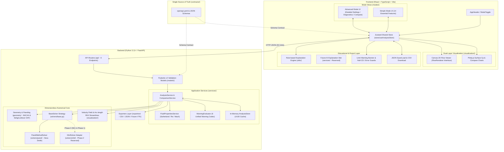
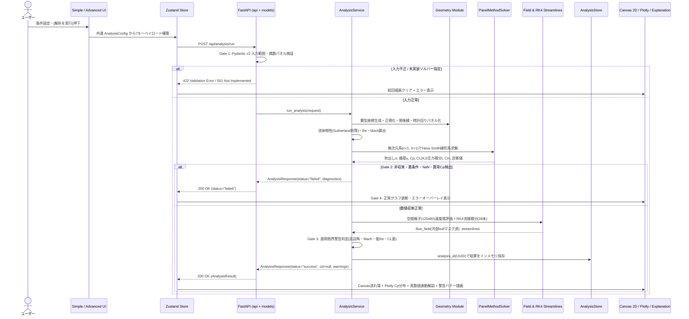
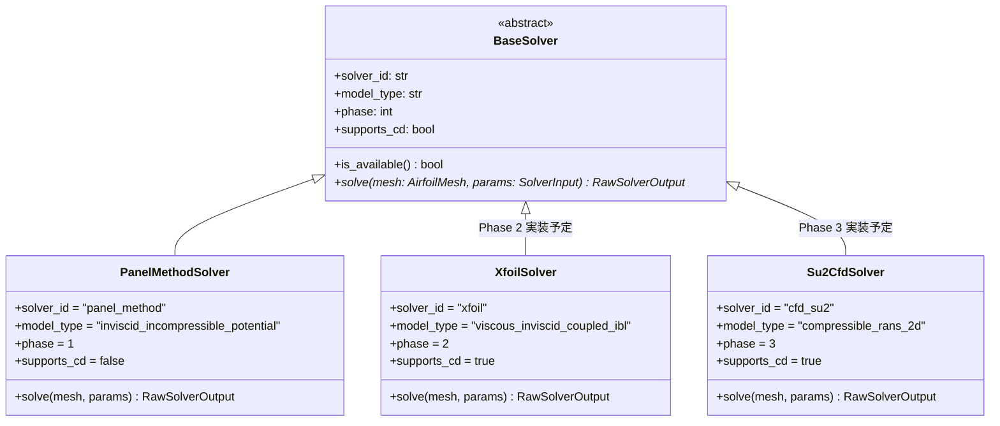

# AirFlow Lab システムアーキテクチャ設計書（ARCHITECTURE.md）

> **文書ステータス**: 初期設計版（Phase 1 実装着手前・正式アーキテクチャ仕様）

## 1. アーキテクチャ基本方針と設計原則

**AirFlow Lab** は、高校生や流体力学の初学者が「2次元翼型周りの流れと揚力発生のしくみ」を直感的に理解し、さらに探究活動・風洞実験比較へと段階的にステップアップできる **教育重視型Webベース2D流体解析ソフトウェア** である。

本システムは、単なる「きれいな図を出す可視化ツール」ではなく **「物理的に誠実で、計算結果の意味とモデルの限界を正しく理解できるソフトウェア」** を実現するため、以下の5つのアーキテクチャ原則を厳守する。

1. **物理的誠実性と限界の明示（Honest Physics First）**
   - Phase 1 の計算エンジンを「2次元・非圧縮・非粘性のポテンシャル流れ（Hess-Smith パネル法）」と明確に定義し、粘性CFDであるかのような誤認を与える表現をUI・API・出力ファイルの全層で排除する。
   - 非粘性モデルでは原理的に算出できない抗力係数 $C_D$ を `0` として出力することを型・構造レベルで禁止し、常時 `null`（UI表示：`—（算出不可）`＋理由明示）とする。
   - 高迎角時の境界層剥離・失速未考慮や圧縮性影響などの適用限界をバックエンドで定量判定し、フロントエンドで常時警告表示する。
2. **簡易モードと本格モードの単一基盤共有（Single Source of Truth）**
   - 「簡易モード」と「本格モード」で計算エンジンや状態モデルを二重実装しない。フロントエンドの単一状態ストア（`AnalysisConfig` / `AnalysisResult`）とバックエンドの同一解析パイプラインを共有し、**UIの入力粒度と診断表示の詳細度のみを切り替える**。これにより、同一解析条件であれば両モードで **100%同一の計算結果** が得られることを構造的に保証する。
3. **契約駆動開発（Contract-Driven Architecture）**
   - `contracts/` 配下の OpenAPI 3.1（`openapi.yaml`）および JSON Schema（`analysis_request.schema.json`, `analysis_response.schema.json`）をフロントエンド・バックエンド間の Single Source of Truth とし、SI単位系・許容範囲・`null` 許容条件・エラー形式を厳密に一致させる。
4. **数値計算コアの独立性とテスト容易性（Clean Numerical Core）**
   - 翼型幾何生成（`geometry/`）、パネル法ソルバー（`solvers/`）、流れ場・流線積分（`visualization/`）をWebフレームワーク（FastAPI）から完全に切り離した純粋Python＋NumPy/SciPyモジュールとして設計する。さらにソルバー内部は無次元系（$\hat{c}=1, \hat{V}_\infty=1$）で統一し、`pytest` から直接厳密解比較・V&V（Verification & Validation）を実行可能にする。
5. **Phase 1 → Phase 2 → Phase 3 の段階的拡張性（Extensible Strategy Design）**
   - バックエンドの `BaseSolver`（Strategyパターン）、データ出力の `exporters/` 層、フロントエンドの `FlowRenderer` 描画抽象インターフェースにより、Phase 2（XFOIL粘性・非粘性連成）、Phase 3（SU2等の本格2D粘性CFD・非同期ジョブ・WebGL大規模描画・VTK出力）へ既存UIやAPI契約を破壊せず拡張できる構造とする。また、未実装フェーズの機能はモックやダミー値で完成扱いにせず、UI上の `disabled` 明示と API の `501 Not Implemented` で誠実に制御する。

---

## 2. システム全体像

### 2.1 採用技術スタックと選定理由

| レイヤー | 採用技術 | 選定理由 |
| :--- | :--- | :--- |
| **フロントエンド基盤** | React 18 + TypeScript + Vite | 厳格な型安全性により `cd: null` 等の物理ガードをコンパイル時に強制でき、高速なHMR・ビルド環境を提供するため。 |
| **フロントエンド状態管理** | Zustand | ボイラープレートが少なく、簡易モード／本格モード横断の単一ストア（`AnalysisConfig` / `AnalysisResult` / `CompareState`）を明快かつセレクタ最適化された形で共有できるため。 |
| **2D流れ場描画** | HTML5 Canvas 2D（`FlowRenderer` 抽象化） | Phase 1 の標準格子（`120x80`）コンター（オフスクリーン `ImageData` 双線形補間）と流線28本・ベクトル・翼型ポリゴン描画において60fps相当で高速動作し、高DPI対応・ツールチップ座標逆変換の保守性に優れるため。将来の大規模格子向けにWebGL差替インターフェースを備える。 |
| **科学技術グラフ描画** | Plotly.js | 航空工学標準の縦軸反転（$-C_p$ 上向き）切替、上下表面の色分け、2条件重ね合わせ比較、ズーム・ホバー数値読取に標準対応しているため。 |
| **バックエンドAPI基盤** | Python 3.11+ / FastAPI / Pydantic v2 | OpenAPI 3.1 との親和性が高く、Pydantic v2 による高速かつ厳密な物理パラメータ検証と科学計算エコシステムへの直結が可能なため。 |
| **数値計算エンジン** | NumPy / SciPy (`linalg`, `interpolate`) | Hess-Smith $(N+1)\times(N+1)$ 密行列の高速求解（`scipy.linalg.solve`）、空間格子の2次元ブロードキャスト評価、カスタム翼型の弧長3次スプライン補間（`CubicSpline`）を高精度・数十ms以内で実行できるため。 |
| **契約・スキーマ管理** | OpenAPI 3.1.0 / JSON Schema (2020-12) | リクエスト7キー・必須6エンドポイント・統一エラー形式を言語非依存で厳密定義し、契約テストに利用できるため。 |
| **自動テスト基盤** | pytest / Vitest / React Testing Library / Playwright | 数値計算V&V（円柱厳密解・薄翼理論）、単体テスト、簡易/本格一致テスト、E2Eシナリオを一貫検証するため。 |

### 2.2 システム全体アーキテクチャ図



### 2.3 解析実行データフロー（シーケンス図）



---

## 3. フロントエンドアーキテクチャ設計

### 3.1 簡易モード / 本格モードの単一状態共有設計
フロントエンドの状態は `frontend/src/store/useAnalysisStore.ts`（Zustand）に集約し、以下の単一状態ツリーで管理する。

- **`config: AnalysisConfig`**: APIリクエストのトップレベル7キー（`airfoil`, `angle_of_attack`, `velocity`, `chord_length`, `fluid_properties`, `solver`, `numerical_settings`）と1対1対応する現在の解析条件。
- **`uiMode: "simple" | "advanced"`**: 現在の画面表示モード。
- **`isAdvancedCustomized: boolean`**: 本格モードで詳細パラメータ（標準以外のパネル数、直接物性値、カスタムDAT翼型など）が変更されたかどうかを示すフラグ。
- **`currentResult: AnalysisResult | null`**: 最新の解析結果（エラー・非収束状態を含む）。
- **`compareState: { pinnedBase: AnalysisResult | null; isCompareActive: boolean }`**: 本格モードの2条件比較状態。
- **`viewSettings: VisualizationSettings`**: 流線ON/OFF、速度ベクトルON/OFF、背景コンター種別（なし / 速度比 $|V|/V_\infty$ / 圧力係数 $C_p$）、座標視点（翼固定標準 / 風洞視点）、$C_p$ グラフ縦軸反転ON/OFF、ホバー中 $x/c$ 座標。

**モード切替時の一貫性保証ルール**:
1. 初期状態（簡易モード）では、`num_panels = 160`, `closed_te = true`, `grid_nx = 120`, `grid_ny = 80`, `num_streamlines = 28`, 標準空気（$293.15\text{ K}, 101325\text{ Pa}$）が `config` にセットされる。
2. **簡易モード → 本格モード**: `config` と `currentResult` を一切変換せずそのまま引き継ぐ。
3. **本格モード → 簡易モード**: 本格モードで詳細設定を変更していた場合でも勝手に標準値へ上書きリセットせず、`config` を維持したまま簡易モード左ペイン上部に **「本格モードの詳細設定を適用中（標準設定に戻す）」** バッジを表示する。これにより、モードを行き来しても同一条件で100%同一の解析結果が維持される。

### 3.2 `modes/simple`・`modes/advanced`・`components/` の責務分離
画面は **固定ヘッダー＋3ペイン構成（左：条件設定、中央：2層可視化、右：KPI・警告・解説/診断）** を共通骨格とし、以下のように責務を分離する。

- **`components/`（モード非依存の共通UI部品）**:
  - ヘッダー（物理モデル明示バッジ `2D 非粘性ポテンシャル流れ（パネル法）`、モード切替トグル、APIヘルスインジケータ）。
  - KPIカード群（$C_L$, $Re$, $M$, $C_{m,c/4}$, および `cd === null` 専用の算出不可表示カード）。
  - 適用限界警告バナー（`WarningBanner`）、エラー・非収束遮断オーバーレイ（`ErrorOverlay`）、学習解説パネル（`EducationalExplanation`）。
- **`modes/simple/`（簡易モード専用モジュール）**:
  - 高校生が迷わず操作できる1画面完結の入力パネルを提供し、必要14機能（NACA 0012/2412/4412/6412 シルエット付き選択＋カスタム翼型拡張枠案内、$|\alpha|>10^\circ$ 注意帯付き迎角スライダー、風速、翼弦長、流体プリセット選択、解析実行ボタン、流れ場・コンター・$C_p$・$C_L$・$Re$・高校生向け解説）を直感的ラベルで統合する。
- **`modes/advanced/`（本格モード専用モジュール）**:
  - 探究・研究用途向けに左ペインを構造化アコーディオン（①翼型：NACA任意4桁・Selig/Lednicer DAT/CSV読込・座標テーブル・将来の座標編集枠 `準備中` 明示、②流れ・物性：温度自動推算／$\rho,\mu$ 直接／$\rho,\nu$ 直接の3モード切替＋$Re, M$ リアルタイムプレビュー、③計算手法・数値設定：ソルバー選択［Phase 2 XFOIL・Phase 3 CFDは `disabled` かつ予定明記］、パネル数 `40..300` 偶数・後縁閉合・格子・流線本数）で構成する。
  - 右ペインに解析診断タブ（収束成否、行列条件数、Kutta-Joukowski $C_L$ と圧力積分 $C_{L,p}$ のクロスチェック差、計算時間）および2条件比較操作・入出力パネルを配置する。

### 3.3 Canvas 2D + Plotly.js 二層描画アーキテクチャ（`visualization/`）

1. **上段：2D流れ場ビューア（Canvas 2D + `FlowRenderer` インターフェース）**
   - 描画処理を `FlowRenderer` インターフェース（`renderField()`, `setViewport()`, `hitTest()`）で抽象化し、Phase 1 では `Canvas2DFlowRenderer` により実装する。
   - **レイヤー合成順序**: ①オフスクリーンCanvasで生成した双線形補間コンター `ImageData`（速度比 $|V|/V_\infty$ は色覚多様性に配慮した **Viridis**、圧力係数 $C_p$ は $C_p=0$ を白・負圧を青・正圧を赤とする発散型 **RdBu**） → ②グリッド速度ベクトル矢印 → ③RK4流線ポリライン → ④翼型閉ポリゴン塗りつぶし＋輪郭線 → ⑤よどみ点・最小 $C_p$ 点マーカー・ホバー十字ガイド。
   - **等方座標変換と視点切替（`utils/coordTransform.ts`）**: 物理座標系とスクリーン座標系の変換では **アスペクト比 1:1 の等方スケーリング** を厳守し、翼型の縦横歪みを防止する。表示モードは、下段の $C_p$ グラフ横軸 $x/c$ と位置が直感対応する **「標準視点（翼型水平固定・一様流を $\alpha$ 回転）」** をデフォルトとし、実際の風洞実験と対比できる **「風洞視点（一様流水平・翼型を $-\alpha$ 回転）」** への切替トグルを備える。
2. **下段：表面 $C_p$ 分布・2条件比較グラフ（Plotly.js）**
   - 航空工学の標準慣例に従い **縦軸反転（$-C_p$ 上向き＝負圧ピークが上）** をデフォルトとし、「通常軸（$C_p$ 上向き）」切替トグルと「なぜ負圧を上向きに描くのか」のミニ注記を併設する。
   - 上面（Suction side：青実線）と下面（Pressure side：赤破線）を明確に色分けし、下部サブプロットに同横軸 $x/c \in [0, 1]$ の翼型断面シルエットを表示する。また上段Canvasのマウスホバー $x/c$ と縦ガイド線を双方向同期する。
   - 2条件比較時は Case A（基準：実線）と Case B（比較対象：破線・別色調）を同一プロット上に重ね合わせる。

### 3.4 ルールベース解説エンジンと将来AI解説サービスの分離

教育的信頼性を担保するため、計算値から論理的に導かれる定式解説と、将来拡張するLLM補助解説をアーキテクチャおよびUIデザインの両面で厳格に分離する。

- **ルールベース解説エンジン（Phase 1 標準：`utils/explanationEngine.ts`）**:
  - 外部通信や確率的生成を一切行わず、`AnalysisResult` の実数値（対称翼/キャンバー翼判定、迎角 $\alpha$、最小圧力係数 $C_{p,\min}$ とその位置 $x/c$、最大速度比 $(|V|/V_\infty)_{\max}$、揚力係数 $C_L$、レイノルズ数 $Re$、警告コード）を入力として決定論的に4ブロック（①結果の要約、②揚力のしくみ、③この計算モデルの前提と限界、④次の探究ヒント）を生成する。
  - **禁止事項の徹底**: 物理学的に誤りである「同着理論（翼上面の方が長いから後縁に同時到達するために速くなる）」は一切使用しない。代わりに、①尖った後縁を滑らかに流れるクッタの条件と循環の発生 → ②翼上面に沿う流線の曲率と向心力に伴う圧力低下（負圧） → ③ベルヌーイの定理による加速 → ④上下表面の圧力差積分（＝空気を下向きに偏向させた反作用）という正しい4段階ロジックで説明し、「よくある誤解（なぜ対称翼 NACA 0012 でも迎角をつけると揚力が出るのか）」の補足枠を常設する。
  - パネル上部に **`ルールベース解説（計算結果に基づく定式生成）`** バッジを明示する。
- **将来AI解説サービス（拡張予約：`services/aiExplanationService.ts`）**:
  - 将来のLLM API連携用インターフェースのみを `services/` 層に分離定義し、UI上はルールベース解説とは独立した別タブ／別枠（異なる配色・アイコン）に配置する。
  - 表示時は **`AI解説（LLM生成・補助説明）`** ラベルとハルシネーション注意注記を必須とし、Phase 1 ではダミー文章を生成せず「将来機能（準備中）」プレースホルダのみを表示する。

---

## 4. バックエンドアーキテクチャ設計

### 4.1 5層レイヤード構成
バックエンド（`backend/app/`）は単一責任の原則に基づき、上位から下位への一方向依存のみを持つ5層構造とする。

1. **APIプレゼンテーション層（`api/`）**: FastAPI ルーター群。必須6エンドポイントのHTTP入出力、ステータスコード制御（`200`, `404`, `422`, `501`, `500`）、統一エラーJSON整形を担当する。数値計算ロジックは一切持たない。
2. **データモデル・契約層（`models/`）**: `contracts/` の JSON Schema / OpenAPI 定義に完全準拠した Pydantic v2 モデル群。リクエスト7キーの型・単位・境界値バリデーションを担う。
3. **アプリケーションサービス層（`services/`）**:
   - `AnalysisService`: 幾何生成 → 物性計算 → ソルバー実行 → 速度場・流線計算 → 警告評価 → キャッシュ保存の一連のワークフローを統括する。
   - `FluidPropertiesService`: 温度・静圧からの理想気体式＋Sutherland則推算、または密度・粘性係数の直接入力から $\rho, \mu, \nu, a$ および無次元数 $Re, M$ を算出する。
   - `WarningEvaluator`: 解析結果と無次元数から統一警告コード6種を判定する。
   - `AnalysisStore` / `ComparisonService`: 解析結果のインメモリ保持と2条件差分計算を担当する。
4. **無次元数値計算コア層（`geometry/`, `solvers/`, `visualization/`）**:
   - `geometry/`: NACA 4桁解析式生成、Selig/Lednicer形式DAT/CSVパーサ、正規化（前縁原点・弦長1・回転補正）、開後縁ブレンド閉合、弧長3次スプライン＋Full-cosine再パネル化、自己交差検査。
   - `solvers/`: `BaseSolver` 抽象基底クラスと具象ソルバー群（Phase 1 は `solvers/panel/` の Hess-Smith 法）。
   - `visualization/`: 空間格子速度場・圧力場の一括ブロードキャスト計算（Winding Number 翼内部判定マスク、パネル極近傍特異値ガード）および弧長正規化4次ルンゲ・クッタ法（RK4）による流線積分。
5. **エクスポータ層（`exporters/`）**: 解析結果・条件を外部保存形式（メタデータヘッダ付CSV、`.airflow.json`、および将来のVTK構造格子 `.vts`/`.vtk`）へ直列化する。

### 4.2 `BaseSolver` Strategyパターン設計（`solvers/base.py`）
Phase 1 から Phase 3 までの複数ソルバーを透過的に扱うため、`solvers/base.py` に以下の抽象契約を定義する。



- `SolverRegistry` がリクエストの `solver.method` を受け取り、利用可能なソルバーインスタンスを返す。
- Phase 1 では `PanelMethodSolver`（`available=True`, `supports_cd=False`）のみが稼働し、`xfoil` や `cfd_su2` が要求された場合は `SolverNotAvailableError` を送出して HTTP `501 Not Implemented` を返す。また `/api/health` エンドポイントはこの `SolverRegistry` のメタデータをそのまま返すため、バックエンドの実装状態とフロントエンドのソルバー選択UI（`available` フラグによる `disabled` 制御）が自動的に同期する。

### 4.3 無次元計算コアと有次元変換層の分離
数値安定性と物理的見通しを最大化するため、無次元計算と有次元物理量変換を明確に二段分離する。

1. **無次元計算コア（$\hat{c} = 1, \hat{V}_\infty = 1$）**:
   - `PanelMethodSolver` および `visualization/` コアは、無次元座標 $(\hat{x}, \hat{y}) = (x/c, y/c)$ と無次元速度比 $\hat{\mathbf{V}} = \mathbf{V}/V_\infty$ のみで計算を行う。
   - これにより、ユーザーが翼弦長 $c = 0.05\text{ m}$（小型風洞模型）を入力しても $c = 2.0\text{ m}$（実機翼）を入力しても、影響係数行列 $M$ のスケーリングと条件数 $\kappa(M)$ が完全に不変となり、丸め誤差の増大を防止できる。
   - **物理的性質の明確化**: Phase 1 の非粘性・非圧縮ポテンシャル流では、無次元空力係数（$C_p(\hat{x}), C_L, C_{m,c/4}$）および無次元流線形状はレイノルズ数 $Re$ やマッハ数 $M$ に依存せず、翼型形状と迎角 $\alpha$ のみで決まる。この構造をコード上でも分離することで、理論通りの性質を厳密に保つ。
2. **有次元変換・妥当性評価層（`services/`）**:
   - `FluidPropertiesService` が入力された流速 $V_\infty\text{ [m/s]}$、翼弦長 $c\text{ [m]}$、流体物性（$\rho, \mu, \nu, a$）から有次元量（レイノルズ数 $Re = \rho V_\infty c / \mu$、マッハ数 $M = V_\infty / a$、有次元循環 $\Gamma = V_\infty c \hat{\Gamma}\text{ [m}^2/\text{s]}$、動圧 $q_\infty = \frac{1}{2}\rho V_\infty^2\text{ [Pa]}$）を算出する。
   - 算出された $Re, M$ および局所最大流速 $V_{\max} = V_\infty \cdot \max(|\hat{\mathbf{V}}|)$ を `WarningEvaluator` に渡し、非圧縮・薄境界層近似が現実の流れに対して妥当かどうかを判定する。

### 4.4 インメモリ結果キャッシュ/ストア設計（`GET /api/analysis/{id}`・`compare` 対応）
Phase 1 では外部DB（PostgreSQL/Redis等）のセットアップ負荷を排し、Windowsローカル環境で即座に動作するよう、`services/analysis_store.py` にスレッドセーフな **LRUインメモリ結果ストア（`InMemoryAnalysisStore`）** を実装する。

- **保存構造**: `OrderedDict[str, AnalysisResponse]`（`threading.RLock` 保護、最大保持件数デフォルト `50` 件、超過時は最古エントリを自動破棄。可視化用の `flow_field`・`streamlines` 配列は有効小数6桁丸めによりメモリ・通信量を最適化し、`surface`・`coefficients`・`diagnostics` は倍精度を維持する）。
- **`POST /api/analysis/run` 連携**: 解析実行ごとに UUID v4 の `analysis_id` と ISO 8601 タイムスタンプ `created_at` を発行してストアへ格納し、レスポンスとして返却する。
- **`GET /api/analysis/{analysis_id}` 連携**: ストアから該当IDを $O(1)$ で取得して返却する。未存在IDに対しては統一エラー形式の HTTP `404 Not Found`（`code: "ANALYSIS_NOT_FOUND"`）を返す。
- **`POST /api/analysis/compare` 連携**:
  - ①保存済みID指定（`base_analysis_id`, `target_analysis_id`）の場合はストアから結果を取得して再計算コストゼロで即座に比較レスポンスを生成する。
  - ②リクエスト条件直接指定（`base_request`, `target_request`）または片方のみID指定の場合は、不足分を `AnalysisService` でオンデマンド解析・キャッシュ登録した上で比較差分 `diff`（`delta_cl`, `delta_cm_quarter_chord`, `delta_cd`, `delta_cp_min`, `delta_reynolds_number`, `delta_mach_number`）を算出する。
- **将来拡張性**: ストア操作を抽象インターフェース（`save`, `get`, `exists`）越しに行うことで、Phase 3 の非同期CFDジョブ導入時には `SqliteAnalysisStore` や `RedisAnalysisStore` へサービス層無変更で移行できる。

---

## 5. エラー・非収束遮断パイプラインと物理ガード設計

「不正確な数値や未収束データを正常な物理結果としてユーザーに見せない」ため、バックエンドからフロントエンドまで貫通する **4段階の遮断・警告ゲート** を設ける。

| ゲート段階 | 担当層 | 検出条件（定量基準） | システム挙動・UI出力 |
| :--- | :--- | :--- | :--- |
| **Gate 1: 入力・契約検証ゲート** | Backend `models/` & `geometry/` | ・$V_\infty < 0.01$, $c < 10^{-4}$, $\rho \le 0$, $\mu \le 0$, $\nu \le 0$, $T < 50\;\mathrm{K}$<br>・$|\alpha| > 45^\circ$<br>・`num_panels` が範囲 `[40, 300]` 外または奇数<br>・カスタムDATの点数不足・パース不能・上下表面の自己交差<br>・未実装ソルバー（`xfoil`, `cfd_su2`）の指定 | ・計算を実行せず即時拒否<br>・入力不正は HTTP `422 Unprocessable Entity`、未実装ソルバーは HTTP `501 Not Implemented` を統一エラーJSON `{ "error": { "code", "message", "details" } }` で返却 |
| **Gate 2: 数値健全性・非収束遮断ゲート** | Backend `solvers/` & `services/` | ・線形系求解での特異行列例外（`LinAlgError`）<br>・影響係数行列の条件数悪化 `cond(M) > 1e10`<br>・線形方程式の最大残差 $\|M\mathbf{q} - \mathbf{b}\|_\infty > 10^{-8}$<br>・解ベクトルまたは速度場への `NaN` / `Inf` 混入<br>・非物理的な圧力発散 $\min_i C_{p,i} \le -500$ または $\max_i C_{p,i} > 1.0 + 10^{-6}$ | ・不正確な流れ場・流線の生成を中止<br>・`status: "failed"`, `diagnostics.converged: false` と失敗理由コードを返却（正常時の `surface` / `flow_field` データを混在させない） |
| **Gate 3: 物理的適用限界警告ゲート** | Backend `WarningEvaluator` | ・$10^\circ < |\alpha| \le 12^\circ$ → `HIGH_AOA_CAUTION` (`warning`)<br>・$|\alpha| > 12^\circ$ → `STALL_UNMODELED` (`critical`)<br>・$0.3 \le M < 0.7$ → `COMPRESSIBILITY_CAUTION` (`warning`)<br>・$M \ge 0.7$ または $V_{\max} \ge a$ → `TRANSONIC_OUT_OF_RANGE` (`critical`)<br>・$Re < 5\times 10^4$ → `LOW_RE_CAUTION` (`info`)<br>・$C_L$ クロスチェック相対差 $> 5\%$（小揚力 $|C_L| < 0.2$ 時絶対差 $> 0.01$）→ `CL_CROSSCHECK_WARN` (`warning`)<br>・カスタム翼型補正／後縁自動閉合 → `CUSTOM_AIRFOIL_NORMALIZED` / `OPEN_TE_CLOSED_AUTO` (`info`)<br>・Phase 1 パネル法における抗力係数 → `cd: null` 強制 | ・`warnings[]` 配列に構造化警告オブジェクトを付与<br>・圧力積分の抗力方向残差は `diagnostics.cd_pressure_numerical_error` のみに閉じ込め、`coefficients.cd` は必ず `null` とする |
| **Gate 4: UI描画遮断・誠実表示ゲート** | Frontend `store/` & `components/` | ・APIエラー受信または `result.status !== "success"`<br>・`result.coefficients.cd === null`<br>・`result.warnings.length > 0` | ・失敗時は**前回の正常な流れ場Canvas・$C_p$グラフを即座にクリア**し、`ErrorOverlay`（原因と対処案内）のみを表示<br>・`cd === null` 時は `0` 表示を禁止し `—（算出不可）` と非粘性モデルの理由を表示<br>・警告存在時は右ペイン最上部に折りたたみ不可の強調バナーを表示 |

---

## 6. ディレクトリ構造詳細と変更・追加理由

### 6.1 プロジェクト全体ディレクトリツリー（Phase 1〜3 実装予定を含むターゲット構成）
※現時点では初期設計文書6点・`README.md`・`contracts/` 定義のみを作成済みであり、`frontend/`・`backend/`・`tests/` 配下は Phase 1 実装承認後に順次作成する。
開発指示書 第4章の基本構成を完全に維持した上で、状態共有・純粋関数分離・ソルバー抽象化・出力拡張のために4つの要素（`[追加]` 印）を配置する。

```text
AirFlowLab/
├── README.md                          # セットアップ手順・起動方法・物理的前提の総合案内
├── PRODUCT_SPEC.md                    # 製品仕様書（簡易14機能・本格18機能・UI/解説/警告仕様）
├── ARCHITECTURE.md                    # 本書（システム構成・データフロー・拡張アーキテクチャ）
├── NUMERICAL_METHOD.md                # 理論・数値計算仕様書（Hess-Smith定式化・RK4・限界定義）
├── API_SPEC.md                        # API詳細仕様・入出力フォーマット定義書
├── TEST_PLAN.md                       # 品質検証・V&Vテスト計画書（必須11項目＋厳密解検証）
├── TASK_PLAN.md                       # 環境構築計画・Phase 1 実装ロードマップ・ファイル所有権定義
│
├── frontend/                          # フロントエンド（React + TypeScript + Vite）
│   ├── package.json
│   ├── tsconfig.json
│   ├── vite.config.ts
│   ├── index.html
│   └── src/
│       ├── main.tsx                   # React エントリポイント
│       ├── App.tsx                    # 全体3ペイン骨格・モード切替ルーティング
│       ├── components/                # モード横断の共通UIコンポーネント（Header, KPI, Warning, Explanation等）
│       ├── modes/
│       │   ├── simple/                # 簡易モード画面・14機能直感コントロールパネル
│       │   └── advanced/              # 本格モード画面・詳細設定・DAT読込・診断・2条件比較UI
│       ├── visualization/             # FlowRenderer抽象・Canvas 2D流れ場描画・Plotly.js Cp/比較グラフ
│       ├── services/                  # FastAPI通信クライアント・将来AI解説サービス窓口
│       ├── types/                     # contracts/と完全同期したTypeScript型定義
│       ├── store/                     # [追加] Zustandによる簡易/本格モード単一共有ストア
│       └── utils/                     # [追加] 等方座標変換・カラーマップ・物性補助・ルールベース解説・CSV/JSON変換純粋関数
│
├── backend/                           # バックエンド（Python 3.11+ / FastAPI / NumPy / SciPy）
│   ├── pyproject.toml                 # Python依存パッケージ・pytest/ruff/mypy設定
│   └── app/
│       ├── main.py                    # FastAPIアプリ初期化・CORS・統一例外ハンドラ
│       ├── api/                       # 必須6エンドポイントのルーティング定義
│       ├── models/                    # Pydantic v2 スキーマ・内部ドメインデータ構造
│       ├── solvers/
│       │   ├── base.py                # [追加] BaseSolver抽象基底クラス・SolverRegistry
│       │   ├── panel/                 # Phase 1: Hess-Smith 2Dパネル法ソルバーコア
│       │   └── xfoil/                 # Phase 2予約枠: XFOIL連携アダプタ（Phase 1では501ガードのみ）
│       ├── geometry/                  # NACA 4桁生成・カスタムDAT正規化/閉合/スプライン再パネル化
│       ├── visualization/             # 空間速度場格子評価（特異値ガード・内部マスク）・弧長RK4流線積分
│       ├── services/                  # 解析オーケストレーション・流体物性(Sutherland則)・警告判定・LRU結果ストア・比較
│       └── exporters/                 # [追加] メタデータ付CSV・.airflow.json・将来VTK(.vts/.vtk)出力層
│
├── contracts/                         # フロントエンド・バックエンド間の単一契約（Single Source of Truth）
│   ├── api/
│   │   └── openapi.yaml               # OpenAPI 3.1.0 完全定義
│   └── schemas/
│       ├── analysis_request.schema.json
│       └── analysis_response.schema.json
│
├── tests/                             # 自動テストスイート（pytest）
│   ├── unit/                          # 幾何・物性・スキーマ・エクスポータ単体テスト
│   ├── numerical/                     # V&V数値検証（円柱厳密解・0012対称性・薄翼理論・Kutta・収束性・RK4）
│   └── integration/                   # API統合・簡易/本格モード結果一致・異常系/非収束遮断テスト
│
└── docs/                              # 補助技術・教育ドキュメント群
    ├── architecture/                  # 詳細設計ノート・Phase 2/3移行ガイド
    ├── physics/                       # 揚力発生の物理・パネル法の前提と限界の解説資料
    ├── numerical_methods/             # 影響係数積分・特異値処理の導出資料
    └── user_guide/                    # 高校生・教育現場向け操作・探究ガイド
```

### 6.2 基本構成に対するディレクトリ・モジュール追加理由
開発指示書 第4章のディレクトリ構成を一切変更・削除せず維持した上で、上記4箇所を追加した技術的理由は以下の通りである。

1. **`frontend/src/store/` の追加理由（単一状態共有と循環依存の防止）**
   - `modes/simple/` と `modes/advanced/` が同一の解析条件（`AnalysisConfig`）と解析結果（`AnalysisResult`）を共有する際、どちらか一方のモード配下に状態を持たせるとモード間の密結合や状態の二重管理が発生する。独立した `store/` 層を設けることで、`simple` と `advanced` を対等な View 層として疎結合に保ち、「同一条件なら両モードで100%同一結果」を構造的に保証できる。
2. **`frontend/src/utils/` の追加理由（純粋関数の分離と単体検証性の向上）**
   - 物理⇔スクリーン1:1等方座標変換（`coordTransform.ts`）、Viridis/RdBuカラーマップ補間（`colormaps.ts`）、入力物性からの $Re, M$ 即時プレビュー計算（`fluidPhysics.ts`）、実数値連動ルールベース解説生成（`explanationEngine.ts`）、CSV/JSON直列化（`csvExporter.ts`, `jsonSerializer.ts`）は、Reactの描画ライフサイクルやHTTP通信に依存しない決定論的な純粋関数である。これらを `components/` や `services/` から `utils/` へ分離することで、DOMを介さない高速・高精度な単体テスト（Vitest）が可能になる。
3. **`backend/app/solvers/base.py` の追加理由（Strategyパターンの明示的契約化）**
   - `solvers/panel/` と `solvers/xfoil/`（および将来の `solvers/cfd/`）が共通の入出力型・能力宣言（`supports_cd`, `phase`, `model_type`）に従うよう、抽象基底クラス `BaseSolver` を `solvers/base.py` として明示化する。これにより `AnalysisService` が具象ソルバーの内部実装を知る必要がなくなり、Phase 2・Phase 3 でのソルバー追加時にAPI層・サービス層の改修を最小化できる。
4. **`backend/app/exporters/` の追加理由（研究データ連携と将来VTK拡張の集約）**
   - AirFlow Lab は教育用途に加え、小型風洞実験の実測 $C_p$ データとの比較や将来のParaView等での可視化連携を見据えている。メタデータヘッダ付きCSVや `.airflow.json` のフォーマット生成責務、および Phase 3 で追加する構造格子 VTK（`.vts` / `.vtk`）出力ロジックを `api/` や `visualization/` から切り離して `exporters/` 層に集約することで、科学データ入出力仕様の保守性と拡張性を高める。

---

## 7. Phase 2・Phase 3 への段階的拡張アーキテクチャ

### 7.1 Phase 2：XFOIL 連携アーキテクチャ（粘性・非粘性連成解析）
Phase 2 では、2次元境界層積分方程式とパネル法を強連成させた **XFOIL** を `solvers/xfoil/` アダプタとして統合し、Phase 1 では算出不可であった **粘性抗力・圧力抗力を含めた抗力係数 $C_D$**、**層流-乱流遷移位置 $x_{\mathrm{tr}}/c$**、および **軽度剥離に伴う揚力傾斜の非線形鈍化** を扱えるようにする。

1. **プロセス分離アダプタ設計（`backend/app/solvers/xfoil/`）**:
   - XFOIL 実行バイナリは FastAPI ワーカープロセスとは完全に分離された一時作業ディレクトリ（`tempfile.TemporaryDirectory`）内で `subprocess.run` によりヘッドレス起動する（グラフィックス出力無効化 `PLOP -> G F`）。
   - 標準入力経由でコマンド列（座標読込 → `PANE` 再パネル化 → `OPER` → `VISC {Re}` → `MACH {M}` → `VPAR`［臨界増幅率 $N_{\mathrm{crit}}$、デフォルト `9.0`、小型風洞比較時は乱流度に応じ変更可］ → `ITER` → `ALFA {alpha}` → `CPWR` / `DUMP`）を送出し、生成された出力ファイルをパースして `RawSolverOutput` に変換する。
   - **タイムアウト・非収束安全制御**: プロセス実行には厳格なタイムアウト（例：`timeout = 10.0s`）を設定し、ハングアップ時はプロセスを強制終了する。また XFOIL 特有の境界層反復未収束（`VISCAL: Convergence failed`）が検出された場合は、残存する途中反復値を正常な $C_L, C_D$ として採用することを厳禁とし、Gate 2 に従って `status: "failed"`（非収束エラー）として返却する。
   - **`cd` 出力の解禁**: `XfoilSolver.supports_cd = True` により、収束成功時のみ `coefficients.cd` に実数値（摩擦抗力 $C_{df}$ ＋ 圧力抗力 $C_{dp}$）を設定する。同じ画面上で Phase 1（パネル法：`cd = null`）と Phase 2（XFOIL：`cd = 数値`）を2条件比較することで、**「粘性の有無が流れと抗力・剥離にどう効くか」** を直接学べる教育的体験を実現する。
2. **Phase 2 着手前の必須調査事項（ライセンス・配布・環境要件）**:
   - **GPLライセンスと配布形態の法的整理**: XFOIL（Mark Drela 氏開発）は **GNU General Public License（GPLv2以降）** の下で公開されている。AirFlow Lab をパッケージ配布またはホスティング公開する際、XFOIL バイナリを同梱配布すると GPL のソースコード開示・ライセンス条件の対象となる可能性があるため、①ユーザーがローカル環境に別途導入した XFOIL 実行ファイルのパスを環境変数 `XFOIL_BIN_PATH` で指定する外部バイナリ参照方式とするか、②GPL準拠でのバンドル配布とするかを Phase 2 開始前に必ず確認・決定する。
   - **OS別実行バイナリ検証**: Windows 11 環境におけるネイティブ `.exe` バイナリ（Fortran コンパイル済バイナリ）の入手性・標準入出力バッファリング挙動・改行コード（CRLF/LF）差異の検証を行う。

### 7.2 Phase 3：本格2D粘性CFD（SU2 / OpenFOAM等）への拡張設計
Phase 3 では、大迎角での大規模剥離・失速後の非定常渦放出や高マッハ数圧縮性流れ（衝撃波）まで解析対象を広げるため、オープンソースCFDソルバー（第一候補：**SU2**［LGPL v2.1、Python連携と空力設計に強み］）を統合する。

1. **非同期ジョブ実行アーキテクチャへの拡張**:
   - パネル法（数十ms）や XFOIL（数秒以内）と異なり、2D RANS CFD は計算に数十秒〜数分を要する。そのため同期エンドポイント `POST /api/analysis/run` に加え、非同期ジョブAPI（`POST /api/jobs` によるジョブ投入、`GET /api/jobs/{job_id}` または WebSocket / Server-Sent Events による反復残差履歴・途中経過のストリーミング通知）を `api/` と `services/` に追加する。
2. **自動メッシュ生成と境界層解像度管理**:
   - `geometry/` の下流に Gmsh Python API を用いた `meshing/` モジュールを追加し、翼型周囲の O型／C型非構造・ハイブリッド境界層メッシュ（壁面第1層高さ $y^+ \approx 1$ の自動推算）を生成して `.su2` / `.cgns` 形式でソルバーへ渡す。
3. **大規模可視化（WebGL）と科学データ出力（VTK）へのシームレス移行**:
   - バックエンドの `exporters/` に `vtk_exporter.py` を実装し、計算格子と物理量フィールドを VTK（`.vtu` / `.vts`）形式で出力可能にすることで、外部可視化ソフト（ParaView）や風洞実験PIV計測データとの高度な比較を可能にする。
   - フロントエンドでは `visualization/FlowRenderer.ts` インターフェースの具象実装として `WebGLFlowRenderer` を追加し、数万〜数十万セルのコンター・流線描画へUIコンポーネント側の変更なしにスケールさせる。
