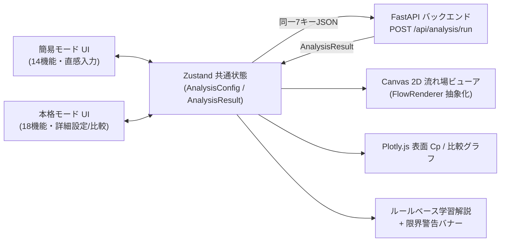

# AirFlow Lab 製品仕様書（PRODUCT_SPEC.md）

> **文書バージョン**: 1.0（Phase 1 実装開始前 統合設計確定版）  
> **対象フェーズ**: Phase 1（2D 非粘性・非圧縮パネル法）※Phase 2（XFOIL）・Phase 3（2D CFD）拡張枠を含む  
> **最終更新**: 2026-11-24

---

## 1. プロジェクト目的・最重要方針

**AirFlow Lab** は、高校生や流体力学の初学者が「2次元翼型周りの流れ」を直感的に操作・可視化し、物理法則と結びつけて理解できる Web ベースの 2D 流体解析アプリケーションである。

### 最重要方針
1. **教育重視（「結果を見せるソフト」ではなく「結果を理解できるソフト」）**
   - 数値や色付き画像を並べるだけでなく、「なぜ上面の圧力が下がるのか」「迎角やキャンバーを変えると何が起きるのか」を実数値連動の解説とインタラクティブな可視化で体験的に学べるようにする。
2. **物理的正確性の徹底**
   - 流体力学的に誤った俗説（例：「同着理論 / Equal Transit-Time Fallacy」）を一切排除し、流線の曲率・圧力勾配・ベルヌーイの定理・循環（クッタの条件）に基づく正しい説明を提供する。
3. **計算の限界を正直に示す**
   - Phase 1 のパネル法（2D 非粘性・非圧縮ポテンシャル流れ）で計算できる量と計算できない量を厳密に区別する。
   - **粘性抗力・剥離・失速・圧縮性衝撃波は計算できない**ことを UI・グラフ・解説・エクスポートファイルすべてで明示し、未実装機能を見た目だけ完成扱いにしない。
4. **簡易モードと本格モードの完全な一貫性**
   - 簡易モードと本格モードは**同一のバックエンド計算エンジン**と**同一のフロントエンド状態モデル（`AnalysisConfig` / `AnalysisResult`）**を共有し、UI の表示粒度のみを切り替える。同一条件では 100% 同一の計算結果を返す。

---

## 2. 対象ユーザーペルソナ

| ペルソナ | 背景・スキル | 主な利用モード | 利用目的・期待する体験 |
| :--- | :--- | :--- | :--- |
| **A. 高校生・初学者** | 高校物理（力学・エネルギー保存）履修中。流体力学や CFD は初めて。 | **簡易モード** | 翼型や迎角をスライダーで動かしながら、流線・速度・圧力・$C_L$ の変化を直感的に観察し、「なぜ翼に揚力が生まれるか」を正しく理解する。 |
| **B. 探究・自主研究を行う中級者** | 航空工学・流体力学に関心があり、自作風洞実験や学会発表に取り組む高校生・学部生。 | **本格モード** | カスタム翼型（DAT/CSV）の読込、パネル数収束確認、2条件比較、表面 $C_p$ の CSV 出力を行い、理論値と風洞実験データとの比較や考察に活用する。 |
| **C. 指導者・教員** | 高校物理・大学の導入講義でデモンストレーションを行う教員。 | **簡易モード / 本格モード** | 画面投影しながら対称翼（NACA 0012）の $\alpha=0^\circ$ と $\alpha=5^\circ$ の違いや、ポテンシャル流モデルの適用限界（高迎角・粘性）を実演する。 |

---

## 3. 基本仕様・共通数値規約

### 3-1. フェーズ別ソルバー構成

| フェーズ | ソルバー ID (`solver.method`) | 物理モデル | 算出可能係数 | Phase 1 での扱い |
| :--- | :--- | :--- | :--- | :--- |
| **Phase 1（初期実装対象）** | `panel_method` | 2D 非粘性・非圧縮ポテンシャル流れ（Hess-Smith パネル法） | $C_L$, $C_{m,c/4}$, $C_p$（**$C_D$ は常時 `null`**） | **Phase 1 で利用可能（デフォルト）** |
| **Phase 2（予定）** | `xfoil` | 2D ポテンシャル流＋積分境界層連成（XFOIL） | $C_L$, $C_D$, $C_{m,c/4}$, $C_p$, 遷移・剥離点 | UI 上 `disabled`（開発予定明記）／ API `501 Not Implemented` |
| **Phase 3（予定）** | `cfd_su2` | 2D 粘性 CFD（RANS / SU2 等） | $C_L$, $C_D$, $C_{m,c/4}$, $C_p$, 剥離渦・後流 | UI 上 `disabled`（開発予定明記）／ API `501 Not Implemented` |

### 3-2. 全モード共通の数値デフォルト・許容範囲

| パラメータ | API フィールド名 | デフォルト値 | 許容範囲・制約 | 備考 |
| :--- | :--- | :--- | :--- | :--- |
| パネル数 | `numerical_settings.num_panels` | **`160`** | **`40`〜`300`（偶数のみ `multipleOf: 2`）** | Full-cosine クラスタリング |
| 後縁閉合 | `numerical_settings.closed_te` | **`true`** | `true` / `false` | `true`: 閉後縁 ($a_4 = -0.1036$)、`false`: 開後縁 ($a_4 = -0.1015$) |
| 流れ場格子数 ($x$) | `numerical_settings.grid_nx` | **`120`** | `40`〜`240` | 空間コンター・速度ベクトル評価格子 |
| 流れ場格子数 ($y$) | `numerical_settings.grid_ny` | **`80`** | `30`〜`180` | 空間コンター・速度ベクトル評価格子 |
| 計算領域 ($x/c$) | `numerical_settings.x_range` | **`[-0.5, 1.6]`** | `x_min < 0`, `x_max > 1` | 無次元翼弦基準（前縁 $0$, 後縁 $1$） |
| 計算領域 ($y/c$) | `numerical_settings.y_range` | **`[-0.7, 0.7]`** | `y_min < 0`, `y_max > 0` | 無次元翼弦基準 |
| 流線本数 | `numerical_settings.num_streamlines` | **`28`** | **`10`〜`60`** | 弧長正規化 RK4 積分 |
| 迎角 $\alpha$ | `angle_of_attack` | **`4.0`** deg | 簡易: `[-10.0, 15.0]` / 本格・API: `[-45.0, 45.0]` | 単位: deg |
| 一様流風速 $V_\infty$ | `velocity` | **`15.0`** m/s | `> 0`（推奨 `0.1`〜`300.0`） | 単位: m/s |
| 翼弦長 $c$ | `chord_length` | **`0.20`** m | `> 0`（推奨 `0.01`〜`10.0`） | 単位: m |
| 標準流体プリセット | `fluid_properties.preset` | **`air_std_20c`** | `air_std_20c`, `air_0c`, `water_20c`, `custom` | 標準空気（20℃, 101325 Pa） |

### 3-3. 簡易モード ⇔ 本格モード切替時の状態保証
- フロントエンドの状態ストア（Zustand）は単一の `AnalysisConfig` および `AnalysisResult` を保持する。
- **簡易 → 本格**: 簡易モードで選択した条件（例：`NACA 2412`, $\alpha=4^\circ$, 標準空気, パネル数 `160`）がそのまま本格モードの各入力欄へ展開される。
- **本格 → 簡易**: 本格モードで変更した詳細設定（カスタム DAT、パネル数変更、流体物性の直接入力など）は**勝手に上書きしない**。簡易モードの上部に **「詳細設定を適用中（標準値に戻す）」バッジ**を表示し、意図しない条件変更を防ぎつつ、同一条件での結果一致を 100% 保証する。

---

## 4. 簡易モードの必要機能（全14項目）

開発指示書 2.2 の 14 項目と 1 対 1 で対応する仕様を以下に定義する。初学者が迷わず操作できるよう、左ペインは 1 画面スクロール内に収まるコンパクトな構成とする。

| No. | 必要機能（指示書2.2対応） | UI ラベル・表示表現 | 配置ペイン | 仕様・初期値・挙動 |
| :---: | :--- | :--- | :--- | :--- |
| **1** | **翼型選択（NACA 4種）** | 「翼の形（翼型）」 | 左ペイン最上部 | `NACA 0012`（対称翼）/ `NACA 2412`（軽キャンバー）/ `NACA 4412`（中キャンバー）/ `NACA 6412`（強キャンバー）を**翼型ミニシルエット付きカード**で選択。初期値：`NACA 2412`。 |
| **2** | **将来のカスタム翼型拡張枠** | 「カスタム翼型（DAT/CSV）」 | 左ペイン（翼型カード直下） | 「自分の翼型データを使うには本格モードへ切替」リンクボタンを配置。さらに将来的な簡易カスタマイズ枠の拡張スロットを予約。 |
| **3** | **迎角スライダー** | 「迎角 $\alpha$（翼の傾き）[°]」 | 左ペイン | 範囲 `-10.0°` 〜 `+15.0°`（`0.5°` 刻みスライダー＋直接数値入力可）、初期値 `4.0°`。**$|\alpha| > 10^\circ$ のスライダー帯をアンバー色、$|\alpha| > 12^\circ$ を赤色でハイライト**し、「剥離・失速注意域」を直感提示。 |
| **4** | **風速入力** | 「風速 $V_\infty$ [m/s]」 | 左ペイン | スライダー（`1.0`〜`100.0` m/s）＋数値入力、初期値 `15.0 m/s`。 |
| **5** | **翼弦長入力** | 「翼の長さ（翼弦長 $c$）[m]」 | 左ペイン | スライダー（`0.05`〜`2.00` m）＋数値入力、初期値 `0.20 m`。 |
| **6** | **基本流体条件選択** | 「流体の種類」 | 左ペイン | プリセット3種：`標準空気 (20℃, 1気圧)`（初期値）/ `低温空気 (0℃, 1気圧)` / `水 (20℃)`。選択中の密度 $\rho$・動粘性係数 $\nu$ を補助テキストで読み取り専用表示。 |
| **7** | **解析ボタン** | 「流れを解析する」 | 左ペイン下端固定 | プライマリ実行ボタン。クリックで `POST /api/analysis/run` を呼び出し、実行中はスピナー表示・二重送信防止。 |
| **8** | **流れ描画** | ツールバー「流線」「速度ベクトル」 | 中央ペイン上段 | Canvas 2D 上に翼型断面＋流線（デフォルト ON、28本）＋速度ベクトル矢印（デフォルト OFF、ON 切替可）を描画。翼固定／風洞視点の切替トグルを併設。 |
| **9** | **速度分布表示** | ツールバー「速度分布 $|V|/V_\infty$」 | 中央ペイン上段 | 背景コンター切替トグルの1つ（初期選択）。無次元速度比 $|V|/V_\infty$ を Viridis カラーマップ＋カラーバーで表示。 |
| **10** | **圧力分布表示** | ツールバー「圧力分布 $C_p$」 | 中央ペイン上段 | 背景コンター切替トグルの1つ。圧力係数 $C_p$ を RdBu 発散カラーマップ（青＝負圧・白＝0・赤＝正圧）＋カラーバーで表示。 |
| **11** | **$C_p$ 表示** | 「翼表面の圧力係数 $C_p$ 分布」 | 中央ペイン下段＋ホバー | Plotly.js による表面 $C_p$ グラフ（デフォルト縦軸反転 $-C_p$ 上向き、上面＝青実線・下面＝赤破線）。流れ場ホバー時の局所 $C_p$ ツールチップ表示。 |
| **12** | **$C_L$ 表示** | KPIカード「揚力係数 $C_L$」 | 右ペイン上部 | サブ説明「翼を持ち上げる力の強さ」付きで主値（Kutta-Joukowski）を大きく表示。参考情報として動圧 $q_\infty = \tfrac{1}{2}\rho V_\infty^2$ [Pa] と単位スパン揚力 $L' = \tfrac{1}{2}\rho V_\infty^2 c\,C_L$ [N/m] を小さく併記し、風速・密度を変えると実際の力がどう変わるかを体感できるようにする（水プリセット選択時は「キャビテーション未考慮」の注記を付す）。$|\alpha| > 10^\circ$ 時は `※剥離未考慮` バッジ付与。併設の $C_D$ カードは常に `—（算出不可）` と非粘性理由を表示。 |
| **13** | **$Re$ 表示** | KPIカード「レイノルズ数 $Re$」 | 右ペイン上部 | 有効数字3〜4桁または指数表記（例：`1.99 × 10⁵`）で表示し、「慣性力と粘性力の比（流れの性質の目安）」のミニ解説を併記。 |
| **14** | **高校生向け結果解説** | 「この結果の解説（ルールベース）」 | 右ペイン下部 | 実数値（翼型・迎角・$C_{p,\min}$・最大速度比・$C_L$・$Re$）を埋め込んだ4ブロック構成の物理解説を常時表示。「よくある誤解（同着理論の否定）」折りたたみコラム付き。 |

---

## 5. 本格モードの全必要機能（全18項目＋将来拡張枠）

開発指示書 2.3 の全 18 項目を網羅し、左ペインは「①翼型」「②流れ条件」「③計算手法・数値設定」のアコーディオン構成、右ペインは「結果・診断」「学習解説」「比較・入出力」のタブ構成とする。

| No. | 必要機能（指示書2.3対応） | UI 配置・操作仕様 | 技術・データ仕様 |
| :---: | :--- | :--- | :--- |
| **1** | **翼型座標表示** | 左ペイン①「座標テーブルを確認」展開パネル | 生成・読込済み翼型の全節点 $(i, x/c, y/c)$ をスクロール表で表示。最大翼厚比・最大キャンバー比・対称性・後縁閉合状態も表示。 |
| **2** | **翼型データ読込（DAT/CSV）** | 左ペイン①「ファイル読込 / テキスト貼付」 | Selig 形式・Lednicer 形式の `.dat` および `.csv` に対応。`POST /api/airfoils/generate` で正規化・自己交差チェック・スプライン再パネル化を実行し、形状プレビューを表示。 |
| **3** | **将来の翼型座標編集拡張枠** | 左ペイン①「座標編集（Phase 2 予定）」 | ボタンを `disabled` とし、「将来のアップデートで制御点・キャンバー編集に対応予定」と明記（未実装を完成扱いにしない）。 |
| **4** | **迎角の数値入力** | 左ペイン②「迎角 $\alpha$ [deg]」 | 数値入力（範囲 `-45.0` 〜 `+45.0`、ステップ `0.1`）＋微調整スライダー。 |
| **5** | **風速の数値入力** | 左ペイン②「一様流風速 $V_\infty$ [m/s]」 | 正の実数入力（`> 0`）。 |
| **6** | **翼弦長の数値入力** | 左ペイン②「翼弦長 $c$ [m]」 | 正の実数入力（`> 0`）。 |
| **7** | **流体物性の数値入力** | 左ペイン②「流体物性入力モード」 | 3モード切替：<br>• `temperature_auto`：温度 $T$ [K]（℃併記入力可）・静圧 $p_\infty$ [Pa] から理想気体則＋Sutherland 則で自動推算<br>• `direct_mu`：密度 $\rho$ [kg/m³]・粘度 $\mu$ [Pa·s] 直接入力<br>• `direct_nu`：密度 $\rho$ [kg/m³]・動粘性係数 $\nu$ [m²/s] 直接入力 |
| **8** | **$Re$・マッハ数 $M$ の表示** | 左ペイン②プレビュー＋右ペイン KPI | 入力変更に応じて $Re = \rho V_\infty c / \mu$ および $M = V_\infty / a$ をリアルタイム計算プレビューし、解析後はバックエンド確定値を表示。 |
| **9** | **計算手法（ソルバー）選択** | 左ペイン③「ソルバー選択」 | ラジオカード形式：<br>• `panel_method`：**選択可**（2D 非粘性・非圧縮ポテンシャル流）<br>• `xfoil`：**disabled**（Phase 2 予定・粘性境界層連成）<br>• `cfd_su2`：**disabled**（Phase 3 予定・2D RANS CFD） |
| **10** | **パネル数等の数値設定** | 左ペイン③「数値計算設定」 | • パネル数 `num_panels`: `40`〜`300`（偶数のみ、デフォルト `160`）<br>• 後縁閉合 `closed_te`: チェックボックス（デフォルト `true`）<br>• 流れ場格子 `grid_nx`（デフォルト `120`）, `grid_ny`（デフォルト `80`）<br>• 計算領域 `x_range`（`[-0.5, 1.6]`）, `y_range`（`[-0.7, 0.7]`）<br>• 流線本数 `num_streamlines`: `10`〜`60`（デフォルト `28`） |
| **11** | **収束状況・計算エラー表示** | 右ペイン「結果・診断」タブ | 収束フラグ、係数行列の条件数 `condition_number`、線形残差 `linear_residual_max`、後縁圧力差 `te_cp_diff`、圧力積分抗力残差（数値誤差）`cd_pressure_numerical_error`、計算時間 [ms] を表示。非収束・エラー時は正常結果をクリアし診断オーバーレイのみ表示。 |
| **12** | **表面 $C_p$ 分布詳細表示** | 中央ペイン下段 Plotly グラフ | 反転軸切替（$-C_p$ / $C_p$）、ズーム・パン・PNG保存、$C_{p,\min}$ 位置 $x/c$ マーカー、上面/下面個別ホバー数値表示。 |
| **13** | **揚力係数 $C_L$ 詳細表示** | 右ペイン KPI＋診断欄 | 主表示 `cl`（Kutta-Joukowski 定理）と検証値 `cl_pressure_integration`（表面圧力積分）、および差分 `cl_discrepancy` を明示。 |
| **14** | **抗力係数 $C_D$ 表示** | 右ペイン KPI | Phase 1 パネル法では**常時 `—（算出不可）`** と表示し、「非粘性モデルのため粘性・剥離抗力は算出不可（Phase 2 XFOIL で対応予定）」の理由ツールチップを常設。数値 `0` の表示は厳禁。 |
| **15** | **ピッチングモーメント係数 $C_{m,c/4}$** | 右ペイン KPI | 1/4 弦点周りのモーメント係数を表示。**「頭上げ（Nose-up）を正」**の符号規約をラベル横に明記。 |
| **16** | **CSV / JSON エクスポート** | 右ペイン「比較・入出力」タブ | • 表面分布 CSV（メタデータコメントヘッダ付き）ダウンロード<br>• 解析結果フル JSON ダウンロード |
| **17** | **解析条件の保存・再読込** | ヘッダー／右ペイン「比較・入出力」 | `.airflow.json` 形式で現在の条件＋要約を保存。ファイル読込でスキーマ検証後に UI 状態へ完全復元し、ワンクリックで再解析可能。 |
| **18** | **2条件比較機能** | 右ペイン「比較・入出力」＋中央グラフ | 現在の結果を **Case A（基準）** としてピン留めし、別条件を **Case B（比較対象）** として実行（`POST /api/analysis/compare`）。表面 $C_p$ 重ね合わせグラフ（実線 vs 破線）、KPI 差分テーブル（$\Delta C_L, \Delta C_{m,c/4}, \Delta C_{p,\min}, \Delta Re$）、流れ場切替／並列確認を提供。 |

### 将来拡張枠（Phase 2 / Phase 3 予約・UI上「準備中」明示）
- **座標編集ツール**: キャンバー線・厚み分布のインタラクティブ編集（Phase 2+）。
- **AI 補助解説**: ルールベース解説とは別タブで LLM による対話的補足を提供（Phase 2+、Phase 1 では「将来機能・準備中」枠のみ）。
- **風洞実験データ読込・重ね合わせ比較**: 実験で得た表面 $C_p$ CSV を読み込み、解析結果の Plotly グラフ上へ散布図として重ねる機能（Phase 2+）。
- **VTK（`.vts` / `.vtk`）エクスポート**: ParaView 等で外部可視化するための構造格子出力（Phase 3）。

---

## 6. 画面構成・レイアウト設計（3ペイン構成）

```text
+---------------------------------------------------------------------------------------------------+
| [AirFlow Lab]  バッジ: 2D 非粘性ポテンシャル流れ(パネル法)   [ 簡易モード | 本格モード ]  [状態:●OK] |
+-------------------------+---------------------------------------------+---------------------------+
| 左ペイン (320-360px)    | 中央ペイン (可変幅・メイン可視化領域)          | 右ペイン (350-400px)       |
|                         |                                             |                           |
| [簡易モード時]           | +-----------------------------------------+ | [! 適用限界警告バナー]     |
|  ・翼型カード(4種)       | | [流線ON][ベクトル][速度|圧力][視点切替]  | |  (高迎角/圧縮性/低Re等)  |
|  ・迎角スライダー        | |                                         | |                           |
|  ・風速 / 翼弦長         | |     2D 流れ場ビューア (Canvas 2D)       | | +-------+-------+-------+ |
|  ・基本流体プリセット    | |     ・翼型断面 + 流線 + コンター         | | |  CL   |  CD   |  Re   | |
|  (詳細設定適用中バッジ)  | |     ・カラーバー + ホバーツールチップ    | | | 0.812 |  —    | 1.99e5| |
|                         | |                                         | | +-------+-------+-------+ |
| [本格モード時]           | +-----------------------------------------+ | (本格: Cm, Mach 追加)     |
|  ▼ ① 翼型(NACA/DAT/表) |                                             |                           |
|  ▼ ② 流れ・流体物性     | +-----------------------------------------+ | [タブ: 解説 | 診断 | 比較] |
|  ▼ ③ ソルバー・数値設定 | | 表面 Cp 分布グラフ (Plotly.js)          | |                           |
|                         | |  [-Cp上向き(標準) | Cp上向き] [Case比較]  | | 1. 結果の要約              |
|                         | |  ・上面(青実線) / 下面(赤破線)            | | 2. 揚力のしくみ            |
|                         | |  ・下部に同軸 x/c 翼型シルエット連動      | | 3. この計算の前提条件      |
| [  流れを解析する  ]    | +-----------------------------------------+ | 4. 次の探究ヒント          |
+-------------------------+---------------------------------------------+---------------------------+
```



---

## 7. 可視化仕様

### 7-1. 2D 流れ場ビューア（Canvas 2D + 将来 WebGL 抽象化）
- **描画技術選定**: Phase 1 では標準格子 `120 × 80` 規模に対し、オフスクリーン `ImageData`（双線形補間コンター）＋ベクター描画（流線・速度矢印・翼型輪郭）が 60fps 相当で動作し、高 DPI 対応・保守性に優れる **Canvas 2D** を採用する。描画層は `FlowRenderer` インターフェースで抽象化し、Phase 3 の大規模 CFD 格子時に WebGL レンダラへ差し替え可能とする。
- **物理座標 ⇔ スクリーン座標変換**:
  - 物理座標（前縁 $(0, 0)$、後縁 $(1, 0)$、$y$ 上向き正）に対し、**アスペクト比 1:1 の等方スケーリング**を厳守し、翼型が縦横に歪まないようにする。
  - マウスホイールによるズーム、ドラッグによるパン、リセットボタンを標準装備する。
- **表示視点の切替**:
  - **標準（翼固定視点）**: 翼弦を水平に固定し、一様流を迎角 $\alpha$ 傾けて描画する。下段の $C_p$ 分布グラフの横軸 $x/c$ と翼型の水平位置が一致し、学習時の対応付けが直感的に行える。
  - **風洞視点（切替トグル）**: 一様流を水平左→右に固定し、翼型を迎角 $\alpha$ だけ時計回りに回転させて描画する（実際の風洞実験の見た目と対応）。
- **カラーマップ**:
  - **速度分布 $|V|/V_\infty$**: **Viridis**（色覚多様性対応・知覚的均一性・明度単調）。
  - **圧力分布 $C_p$**: **RdBu（発散型）**（$C_p = 0$ を白、負圧 $C_p < 0$ を青系、正圧 $C_p > 0$ を赤系とし、吸い上げと押し上げを直感識別）。
  - 翼内部（`is_inside_airfoil === true`）はニュートラルグレーで塗りつぶし、輪郭線を明瞭に描画する。
- **インタラクティブ・ホバーツールチップ**:
  - マウス位置を物理座標へ逆変換し、翼内部なら「翼型内部」、外部なら双線形補間で $(x/c, y/c)$、$u/V_\infty$、$v/V_\infty$、$|V|/V_\infty$、有次元速度 $|V|$ [m/s]、$C_p$ をリアルタイム表示する。

### 7-2. 表面 $C_p$ 分布・比較グラフ（Plotly.js）
- **縦軸設定**: 航空工学の標準慣例である **縦軸反転（$-C_p$ 上向き＝負圧のピークが上に来る表示）をデフォルト**とする。初学者向けに「通常軸（$C_p$ 上向き）」切替トグルと、「なぜ負圧を上にするのか？（翼上面の吸い上げの強さが山の高さに見えるため）」のミニ解説ツールチップを併設する。
- **系列スタイル**:
  - 上面（Upper / Suction side）: 青実線（`#2563EB`）
  - 下面（Lower / Pressure side）: 赤破線（`#DC2626`）
  - 2条件比較時: Case A を実線、Case B を点線／破線で重ね合わせ、凡例クリックで表示切替可能。
- **翼形状との上下対応**: 横軸を $x/c \in [0, 1]$ に固定し、グラフ直下に同軸の翼型シルエットを配置。Canvas ビューアのホバー位置 $x/c$ とグラフ上の縦ガイド線を同期させる。**風洞視点で翼を回転表示している場合も、同期は回転前の翼弦座標 $x/c$ を基準**に行う。

---

## 8. 学習解説機能仕様

### 8-1. 実数値参照ルールベース解説（Phase 1 標準）
解析結果の JSON から実数値（翼型名・対称/キャンバー区分、$\alpha$、$C_{p,\min}$ とその位置 $x/c$、最大速度比 $(|V|/V_\infty)_{\max}$、$C_L$、$C_{m,c/4}$、$Re$、$M$、警告配列）を参照し、以下の **4ブロック構成** で決定論的に解説を生成する。

1. **結果の要約**:
   - 例：「`NACA 2412`（キャンバー翼）を迎角 `4.0°` に設定した結果、揚力係数 **$C_L = 0.728$**（上向きの揚力）が得られました。」
   - 補助情報：動圧 $q_\infty = \tfrac{1}{2}\rho V_\infty^2$ と単位スパン揚力 $L' = q_\infty c\, C_L$ [N/m] を参考値として併記（例：$V_\infty=15$ m/s, $c=0.2$ m の標準空気で $q_\infty \approx 135.5$ Pa）。水プリセット時は「キャビテーションは未考慮」と注記する。
   - 対称翼 $\alpha=0^\circ$ の場合は「上下対称のため圧力差が生まれず $C_L \approx 0$ となる」ことを具体的に指摘。
2. **揚力のしくみ（正しい物理説明）**:
   - ① **クッタの条件と循環**: 迎角や翼の反り（キャンバー）により、尖った後縁から流れが滑らかに離れるように翼周りに循環が生じ、上面の流れが大きく曲がる。
   - ② **流線の曲率と圧力勾配**: 翼上面では流れが内側へ曲がるための向心力として、周囲より低い圧力（負圧：$C_p < 0$）が形成される。
   - ③ **ベルヌーイの定理と実数値**: 圧力が低いほど空気は加速されるため、今回の解析では上面 **$x/c = 0.04$** 付近で最大流速が一様流の **1.58 倍**、最小圧力係数 **$C_p = -1.50$** となっている。
   - ④ **圧力差の合力**: 上面の吸い上げと下面の押し上げの差が揚力となり、翼が空気を下向きに押し下げた反作用と一致する。
3. **この計算の前提条件と限界**:
   - レイノルズ数 $Re$ の大きさと流れの性質の目安、および現在のモデルが「2次元・非粘性・非圧縮ポテンシャル流れ」であるため、摩擦抗力・剥離・失速は含まれないこと（ゆえに $C_D$ は算出不可）を明記。
4. **次の探究ヒント**:
   - 現在の条件に応じた具体的な実験提案（例：「迎角を `0°` にするとキャンバー翼でも揚力が残るか確認してみよう」「`NACA 0012` に変えて同じ迎角で $C_p$ の山を比べてみよう」）。

### 8-2. 「同着理論」の完全排除と「よくある誤解」コラム
- **禁止事項**: 「翼の上面の方が距離が長いから、前縁で分かれた空気が後縁で同時に合流するために上面が速くなる（同着理論 / Equal Transit-Time Fallacy）」という誤った説明は、コードベース・解説テンプレート・UI 文言のすべてにおいて**絶対禁止**とする。
- **教育的補足（折りたたみコラム）**: 「よくある誤解：空気は後縁で同時に着くの？」を解説パネル下部に配置し、「対称翼 `NACA 0012` は上面と下面の長さが全く同じなのに迎角をつけると揚力が出ること」「実際には上面の空気は下面よりずっと早く後縁に到達すること」を、ユーザーが実際に確認できる手順とともに解説する。

### 8-3. 将来 AI 解説との明確な視覚的分離
- Phase 1 の解説パネル上部には **`ルールベース解説（計算数値に基づく定式生成）`** バッジを常時表示する。
- 将来追加予定の LLM 解説は別タブ（`AI 補助解説（準備中）`）として色調・アイコンを明確に分離し、導入時は `AI生成（補助説明・誤りを含む可能性あり）` のラベルと免責注記を必須とする。Phase 1 ではダミー文章を一切表示しない。

---

## 9. 入出力・データ連携仕様

詳細は [`API_SPEC.md`](file:///c:/home/AirFlowLab/API_SPEC.md) の第3章に定義する。

1. **解析条件の保存・再読込（`.airflow.json`）**:
   - `schema_version: "1.0"`、アプリ名、エクスポート時刻、`config`（`POST /api/analysis/run` の7キー完全準拠）、および任意の `summary`（$C_L, C_{m,c/4}, C_D, Re, M$）を含む JSON ファイル。
   - 再読込時にスキーマ検証を行い、不整合・破損ファイルはエラーメッセージを出して安全に拒否する。
2. **表面分布 CSV エクスポート（`*.csv`）**:
   - 先頭に `#` コメント行でメタデータ（アプリ名、ソルバー種別［非粘性明記］、翼型名、迎角、風速、翼弦長、`density_kg_m3`、`static_pressure_pa`、`dynamic_pressure_pa`、$Re$、$M$、$C_L$、$C_D=\text{N/A}$）を出力。
   - データ列は `index,side,x_c,y_c,cp,vt_over_vinf` とし、Excel や Python、および将来の風洞実験 $C_p$ データとの直接比較が容易な構造とする。
3. **将来の拡張設計（風洞実験データ比較・VTK）**:
   - 表面 CSV と同一の `x_c, cp` 構造を基準として、Phase 2+ で風洞実験データのインポート・重ね合わせプロットに対応可能な設計とする。
   - バックエンドに `exporters/` 層を設け、Phase 3 では `flow_field` 構造格子を `.vts` / `.vtk` 形式で出力できるよう拡張点を確保する。

---

## 10. 絶対に守る7つの計算上の注意への UI / API 対策

| No. | 絶対に守る注意 | UI 対策 | API / データ契約対策 |
| :---: | :--- | :--- | :--- |
| **1** | **パネル法を粘性 CFD と呼ばない** | ヘッダー常時バッジ・ソルバー名・グラフ注記・解説文のすべてに「2D 非粘性ポテンシャル流れ（パネル法）」と明記。 | `solver_info.model_type = "inviscid_incompressible_potential"` を返却し、CSV/JSON メタデータにも明記。 |
| **2** | **高迎角で失速を正確に予測できると見せない** | 迎角スライダーの $|\alpha|>10^\circ$ を色分け。結果最上部に常時展開の警告バナーを表示し、$C_L$ カードに `※剥離未考慮` 注記を付与。 | $10^\circ < |\alpha| \le 12^\circ$ で `HIGH_AOA_CAUTION` (`warning`)、$|\alpha| > 12^\circ$ で `STALL_UNMODELED` (`critical`) を `warnings` に返却。 |
| **3** | **計算できない $C_D$ を `0` や仮数値で出さない** | `cd === null` の場合、必ず `—（算出不可）` と表示し、非粘性モデルの理由ツールチップを常設。`0` 表示を型・コンポーネントで禁止。 | `coefficients.cd` は Phase 1 で常時 `null`、`cd_unavailable_reason` を必須返却。圧力積分の抗力誤差は `diagnostics.cd_pressure_numerical_error` のみに隔離。 |
| **4** | **未実装機能を完成扱いにしない** | XFOIL・CFD・座標編集・AI解説は明確に `disabled` または「Phase 2/3 予定（準備中）」として区別し、ダミー結果を出さない。 | `solver.method` に `xfoil` または `cfd_su2` が指定された場合は `501 Not Implemented` を返却。 |
| **5** | **非収束・数値破綻時に異常結果を正常描画しない** | `status !== "success"` または API エラー時、前回の流れ場・$C_p$・KPI を即座にクリアし、原因と対処案のエラーオーバーレイのみ表示。 | 条件数過大・残差超過・NaN/Inf・$|C_p|>500$ を検出した場合、`status: "failed"`（`coefficients`, `surface`, `flow_field`, `streamlines` は `null`）を返却。異常入力は `422`。 |
| **6** | **誤った「同着理論」を使わない** | 解説エンジンをユニットテストで検証し、禁止語句の混入を防止。「よくある誤解」コラムで逆に誤りを明示解説。 | 解説生成に必要な実数値（`cp_min`, `cp_min_xc`, `max_velocity_ratio`, `cl`）を `diagnostics` / `coefficients` で正確に提供。 |
| **7** | **簡易／本格で結果を違えず、適用限界（$M, Re$）も正直に示す** | 単一ストア共有＋「詳細設定適用中」バッジ。$M \ge 0.3$ / $Re < 5\times 10^4$ / `CL_CROSSCHECK_WARN` も警告バナーへ表示。 | 両モードとも完全に同一の `POST /api/analysis/run` 7キー契約を使用。圧縮性・低 $Re$・クロスチェック差の統一警告コードを返却。 |
