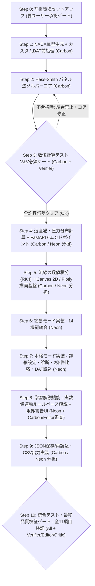

# AirFlow Lab 開発実行計画書（TASK_PLAN.md）

## 1. 開発計画の基本方針とガバナンス

本書は、**AirFlow Lab（Phase 1：2次元非圧縮・非粘性ポテンシャル流れ／Hess-Smith パネル法）** の実装を安全・着実かつ手戻りなく完遂するための環境構築計画・実装ロードマップ・排他的ファイル所有権・品質ゲート（Done Gate）を定義する。

### 1.1 実装進行の絶対原則
1. **数値的正確性ファースト（V&V Gate First）**: UIの見栄えより先に幾何生成とパネル法ソルバーコアを完成させ、**Step 3（数値計算V&Vゲート：円柱厳密解・対称性・薄翼理論・収束性）に全項目合格するまで Step 4 以降のAPI・UI結合へ進まない**。
2. **モック・仮数値による完成偽装の禁止**: ダミー配列や固定の仮数値でグラフを描画して完了扱いとすることを禁止する。また未実装フェーズ（Phase 2: XFOIL、Phase 3: CFD）は選択不可（UI `disabled` ＋ API `501 Not Implemented`）とし、計算できない抗力係数 $C_D$ は必ず `null` として扱う。
3. **排他的ファイル所有権の徹底（競合ゼロ原則）**: マルチエージェント並列実装時は、各ステップでワーカーごとに **「専有編集パス」** を厳密に割り当て、**同一ファイルを複数のエージェントが同時に編集することを全面禁止** する。共有設定ファイル（`pyproject.toml`, `package.json`, `contracts/*`, `README.md`）の更新はステップ境界で司令塔または指名された単一担当者のみが行う。
4. **独立検証の必須化**: 各ステップの完了判定（Done Gate）では、実装者とは独立した検証担当（`Verifier`、および文章・物理表現を監査する `Editor` / `Critic`）がテストと仕様整合を確認し、`OK` を出すまで次ステップへ移行しない。

### 1.2 チーム役割分担定義

| ロール名 | 担当領域・責務 |
| :--- | :--- |
| **司令塔（Coordinator）** | 全体進行管理、ユーザー事前承認ゲート（環境構築・パッケージ導入等）の確認、共有設定ファイル管理、ステップ移行承認、最終統合。 |
| **Carbon（理論・数値計算担当）** | 翼型座標生成・DAT前処理（`geometry/`）、Hess-Smith パネル法ソルバー（`solvers/`）、空間速度場・RK4流線積分（`visualization/`）、流体物性・警告判定・エクスポータ（`services/`, `exporters/`）、数値計算V&Vテスト実装。 |
| **Neon（UI・可視化・API統合担当）** | FastAPI エンドポイント接続（`api/`）、React + TypeScript 基盤、Zustand 共通状態管理（`store/`）、Canvas 2D / Plotly.js 可視化（`visualization/`）、簡易モード14機能・本格モードUI（`modes/`）、ルールベース解説エンジン・入出力UI、フロントエンド単体/統合/E2Eテスト実装。 |
| **Verifier（独立技術検証担当）** | 各ステップの自動テスト（`pytest` / `vitest` / `playwright`）独立実行、OpenAPI/JSON Schema 契約適合性検証、エッジケース・異常系・非収束遮断ガードの技術監査。 |
| **Editor / Critic（校閲・批評担当）** | 初学者向け解説文の物理的正確性監査（**誤った「同着理論」の完全排除**確認）、パネル法を粘性CFDと呼ばない表記統一、審査員・教育現場目線でのUI誠実性レビュー。 |

---

## 2. Step 0：前提環境セットアップ計画（Windows 11）とユーザー承認ゲート

実装（Step 1）に入る前に、Windows 11（PowerShell）ワークスペース `c:\home\AirFlowLab` においてバックエンドおよびフロントエンドの実行・検証環境を整備する。

> [!IMPORTANT]
> **【必須：ユーザー事前承認ゲート（Approval Gate 0）】**
> システムツールの導入、Python仮想環境（`.venv`）の作成、`pip` / `npm` によるパッケージインストールを実行する前には、**必ず司令塔からユーザーへ実行コマンド・導入パッケージ一覧・作成パスを提示し、明示的な承認を得てから実行すること。無断での環境変更コマンド実行は厳禁とする。**

### 2.1 前提ツールの確認（読み取り専用チェック）
まず以下のバージョン確認コマンド（環境変更を伴わない読み取り確認）により、ホストOS上のツール有無を確認する。

| 対象ツール | 必須バージョン要件 | 確認コマンド（PowerShell） | 未導入時の対応方針（要ユーザー承認） |
| :--- | :--- | :--- | :--- |
| **Python** | `3.11` 以上（推奨 `3.11` / `3.12`） | `python --version` | 公式インストーラまたは `winget install Python.Python.3.12` の実行可否をユーザーに確認。 |
| **Node.js / npm** | Node.js `20 LTS` 以上 / npm `10+` | `node --version` / `npm --version` | 公式LTSインストーラまたは `winget install OpenJS.NodeJS.LTS` の実行可否をユーザーに確認。 |
| **Git** | `2.40` 以上 | `git --version` | `winget install Git.Git` の実行可否およびリポジトリ初期化方針をユーザーに確認。 |

### 2.2 バックエンド環境構築手順（承認後に実行）
1. **プロジェクト骨格・`.gitignore` 作成**:
   - `c:\home\AirFlowLab\.gitignore` を作成し、`.venv/`, `node_modules/`, `dist/`, `__pycache__/`, `.pytest_cache/`, `*.pyc`, `.playwright/` を除外指定する。
2. **Python 仮想環境（`.venv`）の作成**:
   ```powershell
   cd c:\home\AirFlowLab
   python -m venv .venv
   .\.venv\Scripts\python.exe -m pip install --upgrade pip
   ```
3. **`backend/pyproject.toml` 配置と厳選パッケージ導入**:
   - **実行時必須パッケージ**: `fastapi`, `uvicorn[standard]`, `pydantic>=2.0`, `numpy`, `scipy`, `python-multipart`
   - **開発・検証用パッケージ**: `pytest`, `httpx`, `jsonschema`, `ruff`, `mypy`
   ```powershell
   .\.venv\Scripts\pip.exe install -e ".\backend[dev]"
   ```

### 2.3 フロントエンド環境構築手順（承認後に実行）
1. **`frontend/package.json`・`tsconfig.json`・`vite.config.ts` 配置**:
   - **実行時必須パッケージ**: `react`, `react-dom`, `zustand`, `plotly.js-dist-min`
   - **開発・検証用パッケージ**: `typescript`, `vite`, `@vitejs/plugin-react`, `@types/react`, `@types/react-dom`, `@types/plotly.js-dist-min`, `vitest`, `jsdom`, `@testing-library/react`, `@testing-library/jest-dom`, `@testing-library/user-event`, `@playwright/test`, `eslint`
2. **npm パッケージインストール**:
   ```powershell
   cd c:\home\AirFlowLab\frontend
   npm install
   ```

### 2.4 Step 0 完了判定基準（Done Gate 0）
- **担当**: 司令塔（環境セットアップ実行） ／ Verifier（疎通確認）
- **合格条件**:
  1. `c:\home\AirFlowLab\.venv\Scripts\pytest.exe --version` が正常終了すること。
  2. `cd c:\home\AirFlowLab\frontend; npm run typecheck`（`tsc --noEmit`）がエラーゼロで動作すること。
  3. 不要なグローバル環境汚染がないこと（Pythonパッケージはすべて `c:\home\AirFlowLab\.venv` 内に隔離されていること）。

---

## 3. Phase 1 実装ロードマップ（Step 4 の順序 1〜10 完全準拠）

### 3.1 ステップ進行フローと品質ゲート構造



### 3.2 全10ステップ一覧サマリ表

| 順序 | ステップ名 | 主実装担当 | 検証・監査担当 | 前提入力 | 主要 Done Gate（完了判定基準） |
| :---: | :--- | :---: | :---: | :--- | :--- |
| **1** | NACA翼型生成（＋カスタムDAT前処理） | Carbon | Verifier | `NUMERICAL_METHOD.md` | 0012対称性・閉後縁 $(1,0)$ 一致・時計回り外向き法線・DAT正規化/自己交差検出の単体テスト全通過 |
| **2** | パネル法ソルバーコア | Carbon | Verifier | Step 1 成果物 | Hess-Smith $(N+1)$ 線形系求解・`BaseSolver` 準拠・`cd is None` 強制・悪条件時の `failed` 返却確認 |
| **3** | **数値計算テスト（V&V必須ゲート）** | Carbon | **Verifier / 司令塔** | Step 1〜2、`TEST_PLAN.md` | **円柱厳密解・0012対称性・薄翼理論 $2\pi$・Kutta条件・パネル収束性の定量基準100%合格（未達なら次工程禁止）** |
| **4** | 速度場・圧力分布計算とFastAPI実装 | Carbon / Neon | Verifier | Step 3 成果物、`contracts/*` | 必須6エンドポイント稼働・リクエスト7キー/レスポンスJSON Schema検証通過・内部 `null` マスク・未実装ソルバー `501` |
| **5** | 流線の数値積分（RK4）とCanvas描画基盤 | Carbon / Neon | Verifier | Step 4 成果物、`PRODUCT_SPEC.md` | 弧長RK4流線28本が翼内部非貫通で停止・Canvas 1:1等方変換・コンター/流線/ベクトル描画・Plotly $-C_p$ 反転グラフ動作 |
| **6** | 簡易モード実装（14機能統合） | Neon | Verifier | Step 4〜5 成果物 | 簡易モード必須14機能が実API連動で完全動作・`cd: null` 時の算出不可表示・エラー時の描画クリア確認 |
| **7** | 本格モード実装（詳細設定・診断・比較・DAT） | Neon | Verifier | Step 6 共通ストア | DAT読込・物性3モード・パネル数設定・診断表示・Case A/B比較動作・未実装ソルバー `disabled`・簡易/本格ペイロード一致 |
| **8** | 学習解説機能（ルールベース解説＋警告UI） | Neon | Carbon / Editor / Critic | Step 6〜7、`NUMERICAL_METHOD.md` | 実数値連動4ブロック解説生成・**「同着理論」表現ゼロ**・将来AI解説枠との視覚分離・高迎角/Mach/低Re警告バナー動作 |
| **9** | JSON保存/再読込・CSV出力実装 | Carbon / Neon | Verifier | Step 7〜8、`API_SPEC.md` | `.airflow.json` 保存→再読込→再計算100%一致・メタデータ `#` 付き表面CSV（非粘性明記・`CD=N/A`）フォーマット検証通過 |
| **10** | **統合テスト・品質検証ゲート** | Carbon / Neon / 司令塔 | **Verifier / Editor / Critic** | Step 1〜9 全成果物、`TEST_PLAN.md` | **必須品質検証11項目＋円柱厳密解・簡易/本格結果一致・異常系/非収束遮断・E2E全通過＋3監査職種すべての `OK` 取得** |

---

## 4. 各ステップ詳細定義（担当・排他的ファイル所有権・入出力・Done Gate）

### Step 1：NACA翼型生成（＋カスタムDAT前処理）
| 項目 | 内容 |
| :--- | :--- |
| **担当** | **主担当**: Carbon ／ **独立検証**: Verifier |
| **排他的ファイル所有権（編集可能パス）** | **Carbon 専有**:<br>- `backend/app/__init__.py`<br>- `backend/app/models/__init__.py`<br>- `backend/app/models/airfoil.py`<br>- `backend/app/geometry/__init__.py`<br>- `backend/app/geometry/naca4.py`<br>- `backend/app/geometry/paneling.py`<br>- `backend/app/geometry/airfoil_io.py`<br>- `tests/unit/test_geometry.py` |
| **入力成果物・受け渡し条件** | - `NUMERICAL_METHOD.md` 第3〜4章（NACA 4桁生成式、Full-cosine クラスタリング、時計回り節点配列、DAT正規化・閉合仕様）<br>- `API_SPEC.md` の翼型関連データ構造 |
| **実装スコープ** | 1. NACA 4桁（`0012`, `2412`, `4412`, `6412` および任意4桁）のキャンバー曲線・厚み分布・法線オフセット座標生成。<br>2. デフォルト閉後縁 `closed_te = True`（$a_4 = -0.1036$）および開後縁オプション（$a_4 = -0.1015$）の実装。<br>3. Full-cosine 節点配置、**時計回り進行（下面後縁 $(1,0) \to$ 前縁 $(0,0) \to$ 上面後縁 $(1,0)$）**、パネル中点・長さ $S_i$・接線 $\mathbf{t}_i$・外向き法線 $\mathbf{n}_i = (-\sin\phi_i, \cos\phi_i)$ 算出。<br>4. パネル数 `num_panels` の許容範囲 `40..300`（偶数のみ、デフォルト `160`）バリデーション。<br>5. カスタム翼型（Selig / Lednicer 形式 DAT・CSV）の自動判別、前縁原点・弦長1への正規化、開後縁の線形ブレンド閉合、弧長3次スプライン再パネル化、上下表面の自己交差検査。 |
| **完了判定基準（Done Gate 1）** | `pytest tests/unit/test_geometry.py` が全件パスし、以下を満たすこと：<br>- NACA 0012 の上下座標対称誤差 $\max |y_U + y_L| < 10^{-15}$。<br>- `closed_te=True` 時に始点・終点が $(1, 0)$ に誤差 $< 10^{-15}$ で一致すること。<br>- 全パネルで $\det[\mathbf{t}_i, \mathbf{n}_i] = +1$ かつ $\mathbf{n}_i$ が翼外向きであること。<br>- Selig形式・Lednicer形式双方のDATから滑らかな `N=160` パネルが生成され、自己交差データや点数不足データに対して明示的な検証例外が送出されること。 |

---

### Step 2：パネル法ソルバーコア
| 項目 | 内容 |
| :--- | :--- |
| **担当** | **主担当**: Carbon ／ **独立検証**: Verifier |
| **排他的ファイル所有権（編集可能パス）** | **Carbon 専有**:<br>- `backend/app/models/solver.py`<br>- `backend/app/solvers/__init__.py`<br>- `backend/app/solvers/base.py`<br>- `backend/app/solvers/panel/__init__.py`<br>- `backend/app/solvers/panel/influence.py`<br>- `backend/app/solvers/panel/hess_smith.py`<br>- `backend/app/solvers/xfoil/__init__.py`（※Phase 2予約スタブ：`supports_cd=True`, `available=False` 宣言と未実装例外のみ）<br>- `tests/unit/test_solver_base.py` |
| **入力成果物・受け渡し条件** | - Step 1 で `Verifier` 承認済みの `backend/app/geometry/` モジュール<br>- `NUMERICAL_METHOD.md` 第5〜7章（Hess-Smith 定式化、分岐切断フリー影響係数、Kutta条件、空力係数式） |
| **実装スコープ** | 1. `BaseSolver` 抽象基底クラスおよび `SolverRegistry`（Strategyパターン）の実装。<br>2. 無次元系（$\hat{c}=1, \hat{V}_\infty=1$）での分岐切断フリー影響係数公式（単一 `atan2` による $\beta$ と対数項 $\Lambda$、自己パネル対角極限 $A_{n,ii}=+1/2, B_{t,ii}=+1/2$）の実装。<br>3. 非貫通境界条件 $N$ 式＋線形 Kutta 条件 $V_{t,1} + V_{t,N} = 0$ の $(N+1)\times(N+1)$ 連立一次方程式の構築・求解（`scipy.linalg.solve`）。<br>4. 表面接線速度比 $V_{t,i}/V_\infty$、表面圧力係数 $C_{p,i}$、主揚力係数 $C_{L,\mathrm{KJ}} = 2\hat{\Gamma}$、検証用圧力積分揚力係数 $C_{L,p}$、$1/4$ 弦点周りモーメント係数 $C_{m,c/4}$（頭上げ正）の算出。<br>5. **抗力係数 `cd = None` のハードコード強制**（圧力積分の抗力方向数値誤差は `diagnostics.cd_pressure_numerical_error` に隔離）。<br>6. 数値健全性ガード（条件数 `cond(M) > 1e10`、線形残差 $> 10^{-8}$、`NaN/Inf`、$\min C_p \le -500$ または $\max C_p > 1.0 + 10^{-6}$ 検出時の `converged=False` / 失敗ステータス返却）。 |
| **完了判定基準（Done Gate 2）** | `pytest tests/unit/test_solver_base.py` が全件パスし、以下を満たすこと：<br>- `PanelMethodSolver` が `BaseSolver` インターフェースを満たし、`cd` がいかなる迎角でも `None` であること。<br>- `SolverRegistry` で `"xfoil"` / `"cfd_su2"` 指定時にモック値を返さず `SolverNotAvailableError` を送出すること。<br>- 退化メッシュ投入時に例外クラッシュせず `converged=False` と診断情報を返すこと。 |

---

### Step 3：数値計算テスト（V&Vゲート：円柱厳密解・0012対称性・薄翼理論・収束性）
| 項目 | 内容 |
| :--- | :--- |
| **担当** | **テスト実装**: Carbon ／ **独立監査・実行**: Verifier ／ **ゲート通過承認**: 司令塔 |
| **排他的ファイル所有権（編集可能パス）** | **Carbon 専有**:<br>- `tests/numerical/test_cylinder_potential.py`<br>- `tests/numerical/test_naca_symmetry.py`<br>- `tests/numerical/test_thin_airfoil_theory.py`<br>- `tests/numerical/test_kutta_and_convergence.py`<br>- `tests/numerical/test_solver_failure_guards.py`<br>（※検証過程でソルバー修正が生じた場合のみ、Carbon が Step 1〜2 専有ファイルを修正し再検証を受ける） |
| **入力成果物・受け渡し条件** | - Step 1〜2 の幾何・ソルバー実装一式<br>- `TEST_PLAN.md` の数値検証（V&V）仕様・定量許容誤差基準 |
| **実装スコープ** | 1. **円柱周り一様流（$\Gamma=0$ ソースパネル法）厳密解比較**: 理論解 $C_p(\theta) = 1 - 4\sin^2\theta$ との最大誤差・RMS誤差検証。<br>2. **対称性・反対称性検証**: NACA 0012 の $\alpha = 0^\circ$ での $C_L=0, C_{m,c/4}=0$, 上下 $C_p$ 完全一致、および $\alpha = \pm 5^\circ$ での $C_L(+\alpha) = -C_L(-\alpha)$ 検証。<br>3. **薄翼理論・翼厚補正理論比較**: 薄対称翼（NACA 0004）の揚力傾斜 $2\pi\text{ rad}^{-1}$ 比較、NACA 0012 の翼厚補正揚力傾斜比較、キャンバー翼（NACA 2412 / 4412 / 6412）のゼロ揚力迎角 $\alpha_{L=0}$ および $C_{m,c/4}(0^\circ)$ 比較。<br>4. **Kutta条件・$C_L$ クロスチェック検証**: 後縁上下圧力一致 $|C_{p,1} - C_{p,N}| \le 10^{-10}$ および $|C_{L,\mathrm{KJ}} - C_{L,p}| / |C_{L,\mathrm{KJ}}| \le 1.5\%$（$N=160, \alpha=5^\circ$）。<br>5. **パネル数収束性・再現性検証**: $N = 60, 120, 160, 240$ での単調収束性と同一入力に対するビット単位の再現性確認。 |
| **完了判定基準（Done Gate 3：必須ブロッキングゲート）** | `pytest tests/numerical/` が全件パスし、`TEST_PLAN.md` の全許容誤差基準（円柱 $N=160$ で $\max|\Delta C_p| \le 0.01$、0012 $\alpha=0^\circ$ で $|C_L| < 10^{-12}$、パネル収束差 $|C_L(240)-C_L(120)|/|C_L(240)| < 0.5\%$ 等）を100%満たし、**`Verifier` と `司令塔` のゲート承認を得ること。本承認なしに Step 4 へ進むことはできない。** |

---

### Step 4：速度場・圧力分布計算とFastAPIエンドポイント実装（Step 4a 先行型確定 → Step 4b 並列実装）
| 項目 | 内容 |
| :--- | :--- |
| **担当** | **Step 4a 契約モデル先行実装**: Neon ／ **Step 4b 並列実装**: Carbon（計算・サービス層）‖ Neon（APIルーター層） ／ **独立検証**: Verifier |
| **排他的ファイル所有権（編集可能パス）** | **Step 4a（Neon 先行確定 → 以降は共有読み取り専用）**:<br>- `backend/app/models/api_schemas.py`<br>**Step 4b Carbon 専有**:<br>- `backend/app/visualization/__init__.py`<br>- `backend/app/visualization/velocity_field.py`<br>- `backend/app/services/__init__.py`<br>- `backend/app/services/fluid_properties.py`<br>- `backend/app/services/warnings.py`<br>- `backend/app/services/analysis_store.py`<br>- `backend/app/services/analysis_service.py`<br>- `tests/unit/test_fluid_and_velocity_field.py`<br>**Step 4b Neon 専有**:<br>- `backend/app/api/__init__.py`<br>- `backend/app/api/routes_health.py`<br>- `backend/app/api/routes_airfoils.py`<br>- `backend/app/api/routes_analysis.py`<br>- `backend/app/main.py`<br>- `tests/unit/test_api_contracts.py` |
| **入力成果物・受け渡し条件** | - Step 3 ゲート合格済みの `geometry/`・`solvers/` モジュール<br>- `API_SPEC.md`、`contracts/api/openapi.yaml`、`contracts/schemas/analysis_request.schema.json`、`contracts/schemas/analysis_response.schema.json` |
| **実装スコープ** | 1. **空間格子速度場・圧力分布計算（Carbon）**: 標準領域 $\hat{x}\in[-0.5, 1.6], \hat{y}\in[-0.7, 0.7]$・標準格子 `120x80` での NumPy 2次元ブロードキャスト速度評価、Winding Number による翼内部判定（内部点は `u_ratio, v_ratio, speed_ratio, cp` をすべて `null` 化）、節点・パネル極近傍の特異値ガード。<br>2. **流体物性・警告判定・結果ストア（Carbon）**: 理想気体式＋Sutherland則／直接入力からの $\rho, \mu, \nu, a, Re, M$ 算出、統一警告コード6種（`HIGH_AOA_CAUTION`, `STALL_UNMODELED`, `COMPRESSIBILITY_CAUTION`, `TRANSONIC_OUT_OF_RANGE`, `LOW_RE_CAUTION`, `CL_CROSSCHECK_WARN`）判定、スレッドセーフ LRU `InMemoryAnalysisStore` と2条件差分算出。<br>3. **FastAPI 必須6エンドポイント実装（Neon）**: リクエスト7キー厳格検証を含む `GET /api/health`, `GET /api/airfoils`, `POST /api/airfoils/generate`, `POST /api/analysis/run`, `GET /api/analysis/{analysis_id}`, `POST /api/analysis/compare`、CORS設定、統一エラーハンドラ（`404`, `422`, `501`）。（※Step 4 時点では `streamlines` は空配列または Step 5 接続用フックとし、Step 5 で実データを結合する） |
| **完了判定基準（Done Gate 4）** | `pytest tests/unit/test_fluid_and_velocity_field.py tests/unit/test_api_contracts.py` が全件パスし、以下を満たすこと：<br>- 全6エンドポイントのレスポンスが `contracts/schemas/analysis_response.schema.json` の JSON Schema 検証に100%合格すること。<br>- 格子内の翼内部点がすべて `null` であり、外部点に `NaN` / `Inf` が1つも含まれないこと。<br>- 不正入力（$V_\infty \le 0$、奇数パネル数等）で `422`、未実装ソルバー指定で `501`、未存在IDで `404` が統一エラー形式で返ること。 |

---

### Step 5：流線の数値積分（RK4）とCanvas描画基盤
| 項目 | 内容 |
| :--- | :--- |
| **担当** | **RK4流線積分（Backend）**: Carbon ／ **Canvas 2D・Plotly描画基盤（Frontend）**: Neon ／ **独立検証**: Verifier |
| **排他的ファイル所有権（編集可能パス）** | **Carbon 専有**:<br>- `backend/app/visualization/streamlines.py`<br>- `backend/app/services/analysis_service.py`（※流線計算呼び出し接続のみ）<br>- `tests/numerical/test_streamlines.py`<br>**Neon 専有**:<br>- `frontend/src/types/api.ts`<br>- `frontend/src/types/analysis.ts`<br>- `frontend/src/types/ui.ts`<br>- `frontend/src/utils/coordTransform.ts`<br>- `frontend/src/utils/colormaps.ts`<br>- `frontend/src/visualization/FlowRenderer.ts`<br>- `frontend/src/visualization/Canvas2DFlowRenderer.ts`<br>- `frontend/src/visualization/FlowFieldCanvas.tsx`<br>- `frontend/src/visualization/FlowLayerToolbar.tsx`<br>- `frontend/src/visualization/FlowTooltip.tsx`<br>- `frontend/src/visualization/CpDistributionChart.tsx`<br>- `frontend/tests/unit/coordTransform.test.ts` |
| **入力成果物・受け渡し条件** | - Step 4 の速度場計算モジュールおよび API スキーマ<br>- `NUMERICAL_METHOD.md` 第9章（弧長正規化RK4仕様）、`PRODUCT_SPEC.md` 第7章（可視化仕様） |
| **実装スコープ** | 1. **弧長正規化4次ルンゲ・クッタ（RK4）流線積分（Carbon）**: 標準 `num_streamlines = 28` 本（許容 `10..60`）、適応弧長刻み（翼近傍 $\Delta s = 0.004$ / 遠方 $0.015$）、4つの終了条件（領域外・翼内部/極近傍到達・よどみ点到達・最大500ステップ）の実装と `AnalysisService` への結合。<br>2. **Canvas 2D 流れ場レンダラ（Neon）**: `FlowRenderer` 抽象インターフェースと `Canvas2DFlowRenderer` 実装（オフスクリーン双線形補間コンター［Viridis / RdBu］、速度ベクトル矢印、RK4流線、翼型閉ポリゴン描画）、**1:1等方アスペクト比座標変換**、「標準視点（翼固定）」⇔「風洞視点（翼回転）」切替、ホバー時の双線形補間ツールチップ。<br>3. **Plotly.js 表面 $C_p$ グラフ（Neon）**: 縦軸反転（$-C_p$ 上向き）デフォルト＋通常軸切替、上面（青実線）／下面（赤破線）色分け、下部翼型シルエット連動表示、Canvasとのホバー $x/c$ 同期。 |
| **完了判定基準（Done Gate 5）** | - `pytest tests/numerical/test_streamlines.py` パス：NACA 0012/4412（$\alpha = -5^\circ, 0^\circ, 10^\circ$）の全流線点列が翼型ポリゴン内部を一切貫通せず、有限ステップで正常停止すること。<br>- `npm run test`（Vitest）パス：`coordTransform.ts` の物理⇔スクリーン往復変換誤差 $< 10^{-6}$、ウィンドウリサイズ時もアスペクト比 1:1 が厳密保持されること。 |

---

### Step 6：簡易モード実装（14機能統合）
| 項目 | 内容 |
| :--- | :--- |
| **担当** | **主担当**: Neon ／ **独立検証**: Verifier |
| **排他的ファイル所有権（編集可能パス）** | **Neon 専有**:<br>- `frontend/src/main.tsx`<br>- `frontend/src/App.tsx`<br>- `frontend/src/App.css`<br>- `frontend/src/store/useAnalysisStore.ts`<br>- `frontend/src/services/apiClient.ts`<br>- `frontend/src/components/layout/AppHeader.tsx`<br>- `frontend/src/components/layout/ModeToggle.tsx`<br>- `frontend/src/components/layout/MainWorkspace.tsx`<br>- `frontend/src/components/results/KpiCards.tsx`<br>- `frontend/src/components/results/ErrorOverlay.tsx`<br>- `frontend/src/modes/simple/SimpleModeView.tsx`<br>- `frontend/src/modes/simple/SimpleControlPanel.tsx`<br>- `frontend/src/modes/simple/AirfoilPresetCards.tsx` |
| **入力成果物・受け渡し条件** | - Step 4〜5 で完成したバックエンド6エンドポイントおよび可視化コンポーネント群<br>- `PRODUCT_SPEC.md` 第4章（簡易モードの必要機能 1〜14 仕様） |
| **実装スコープ** | 1. Zustand 単一共有ストア `useAnalysisStore`（`AnalysisConfig`, `AnalysisResult`, `uiMode`, `viewSettings`）と型安全 `apiClient` の実装。<br>2. 固定ヘッダー（物理モデルバッジ `2D 非粘性ポテンシャル流れ（パネル法）`、モード切替、API接続状態）＋3ペインレイアウトの構築。<br>3. **簡易モード必要14機能の完全統合**: ①翼型選択（NACA 0012/2412/4412/6412）＋②将来のカスタム翼型拡張案内枠、③迎角スライダー（$|\alpha|>10^\circ$ 注意帯ハイライト付）、④風速入力、⑤翼弦長入力、⑥基本流体プリセット選択、⑦解析実行ボタン、⑧流れ描画（流線・ベクトル切替）、⑨速度分布コンター、⑩圧力分布コンター、⑪$C_p$ グラフ表示、⑫$C_L$ 表示、⑬$Re$ 表示、⑭高校生向け結果解説表示スロット。<br>4. `cd === null` 時の `—（算出不可）` 表示ガードおよび API失敗・`status: "failed"` 時の前回描画クリア＋`ErrorOverlay` 表示。 |
| **完了判定基準（Done Gate 6）** | - バックエンド起動状態で簡易モード14機能すべてが実計算データによりエンドツーエンド動作すること（モック・ハードコード数値ゼロ）。<br>- 非収束またはAPIエラー発生時に、直前の正常な流れ場が残存せず即座にクリアされること。 |

---

### Step 7：本格モード実装（詳細設定・診断・2条件比較・DAT読込）
| 項目 | 内容 |
| :--- | :--- |
| **担当** | **主担当**: Neon ／ **独立検証**: Verifier |
| **排他的ファイル所有権（編集可能パス）** | **Neon 専有**:<br>- `frontend/src/utils/fluidPhysics.ts`<br>- `frontend/src/modes/advanced/AdvancedModeView.tsx`<br>- `frontend/src/modes/advanced/AdvancedControlPanel.tsx`<br>- `frontend/src/modes/advanced/AirfoilCoordinatePanel.tsx`<br>- `frontend/src/modes/advanced/FluidPropertiesForm.tsx`<br>- `frontend/src/modes/advanced/SolverSettingsForm.tsx`<br>- `frontend/src/modes/advanced/CompareControlPanel.tsx`<br>- `frontend/src/components/results/DiagnosticsPanel.tsx`<br>- `frontend/src/visualization/CompareChart.tsx`<br>- `frontend/src/App.tsx`（※`AdvancedModeView` マウント接続のみ） |
| **入力成果物・受け渡し条件** | - Step 6 の `useAnalysisStore` および共通レイアウト<br>- `PRODUCT_SPEC.md` 第5章（本格モード全18機能仕様） |
| **実装スコープ** | 1. **翼型詳細パネル**: NACA任意4桁指定、Selig/Lednicer DAT・CSVファイルアップロード（`POST /api/airfoils/generate` 連携）、節点座標テーブル表示、将来の座標直接編集枠（`準備中` 明示）。<br>2. **詳細流れ条件フォーム**: $\alpha, V_\infty, c$ 数値入力、流体物性3モード切替（温度自動推算／$\rho,\mu$ 直接／$\rho,\nu$ 直接）および入力中リアルタイム $Re, M$ プレビュー計算。<br>3. **計算手法・数値設定フォーム**: ソルバー選択（Phase 1 パネル法のみ選択可、**Phase 2 XFOIL・Phase 3 CFD は `disabled` かつ開発予定ラベル明示**）、パネル数 `40..300` 偶数・後縁閉合・格子解像度・流線本数設定。<br>4. **解析診断パネル**: 収束成否、行列条件数、$C_{L,\mathrm{KJ}}$ と $C_{L,p}$ のクロスチェック差、$C_{m,c/4}$、$C_D$ 算出不可理由の詳細表示。<br>5. **2条件比較機能**: 現在の解析結果を Case A としてピン留めし、条件変更後の Case B と `POST /api/analysis/compare` で比較（$C_p$ 分布重ね合わせ `CompareChart` ＋ KPI差分テーブル $\Delta C_L, \Delta C_m, \Delta C_{p,\min}, \Delta Re$）。<br>6. **モード往復一貫性**: 本格モードで詳細設定変更後に簡易モードへ戻した際の「詳細設定適用中（標準値に戻す）」バッジ連携。 |
| **完了判定基準（Done Gate 7）** | - カスタムDAT読込 → 詳細解析 → 診断値確認 → Case A/B 2条件比較が一貫動作すること。<br>- 未実装ソルバー（XFOIL / CFD）がUI上で確実に選択不可（`disabled`）であること。<br>- 簡易モードで設定した条件と、そのまま本格モードへ切り替えて実行したリクエストペイロードおよび返却結果（$C_L, C_p, Re$）が100%一致すること。 |

---

### Step 8：学習解説機能（実数値連動ルールベース解説＋限界警告UI）
| 項目 | 内容 |
| :--- | :--- |
| **担当** | **主担当**: Neon ／ **物理・文章監査**: Carbon・Editor・Critic |
| **排他的ファイル所有権（編集可能パス）** | **Neon 専有**:<br>- `frontend/src/utils/explanationEngine.ts`<br>- `frontend/src/services/aiExplanationService.ts`（※将来拡張インターフェース定義のみ）<br>- `frontend/src/components/results/WarningBanner.tsx`<br>- `frontend/src/components/results/EducationalExplanation.tsx`<br>- `frontend/src/components/results/AiExplanationPlaceholder.tsx`<br>- `frontend/tests/unit/explanationEngine.test.ts` |
| **入力成果物・受け渡し条件** | - `NUMERICAL_METHOD.md` 第11章（正しい4段階揚力説明ロジック・禁止事項）・第8章（警告基準）<br>- `PRODUCT_SPEC.md` 第8章（学習解説機能仕様）・第10章（適用限界警告UI対策） |
| **実装スコープ** | 1. **実数値連動ルールベース解説エンジン（`explanationEngine.ts`）**: 解析結果の実数値（対称/キャンバー判定、$\alpha$、$C_{p,\min}$ とその位置 $x/c$、最大流速比、$C_L$、$Re$、警告状態）を埋め込んだ4ブロック解説（①結果の要約、②揚力のしくみ［クッタ条件・流線曲率と圧力勾配・ベルヌーイの定理・上下圧力差積分］、③モデルの前提条件、④次の探究ヒント）および「よくある誤解（同着理論が誤りである理由：対称翼0012の実例解説）」折りたたみ枠の実装。<br>2. **AI解説との視覚的分離**: `ルールベース解説（計算結果に基づく定式生成）` バッジの明示と、別タブ／別枠での `AI解説（将来機能・準備中）` プレースホルダ分離。<br>3. **適用限界警告バナー（`WarningBanner.tsx`）**: 統一警告コード6種（特に $10^\circ < |\alpha| \le 12^\circ$ の剥離注意・$|\alpha| > 12^\circ$ の失速未考慮重大警告・$M \ge 0.3$ 圧縮性警告）の重要度別常時展開表示と、高迎角時の $C_L$ カードへの `※剥離未考慮` 注記連動。 |
| **完了判定基準（Done Gate 8）** | - `npm run test -- explanationEngine.test.ts` が全件パスすること。<br>- ソースコード全文・生成テキスト全パターンに対し、誤った「同着理論（同時に着く／距離が長いから速い旨の肯定記述）」が含まれないことを自動テスト＋`Editor`/`Critic` 目視監査で確認し `OK` を得ること。<br>- $|\alpha| = 11^\circ$ で `warning`、$|\alpha| = 15^\circ$ で `critical` 警告バナーが確実に表示されること。 |

---

### Step 9：JSON保存/再読込・CSV出力実装
| 項目 | 内容 |
| :--- | :--- |
| **担当** | **バックエンドエクスポータ層**: Carbon ／ **フロントエンド入出力UI・シリアライザ**: Neon ／ **独立検証**: Verifier |
| **排他的ファイル所有権（編集可能パス）** | **Carbon 専有**:<br>- `backend/app/exporters/__init__.py`<br>- `backend/app/exporters/csv_exporter.py`<br>- `backend/app/exporters/json_exporter.py`<br>- `backend/app/exporters/vtk_placeholder.py`（※Phase 3 `.vts`/`.vtk` 拡張インターフェース予約）<br>- `tests/unit/test_exporters.py`<br>**Neon 専有**:<br>- `frontend/src/utils/csvExporter.ts`<br>- `frontend/src/utils/jsonSerializer.ts`<br>- `frontend/src/modes/advanced/ExportImportPanel.tsx`<br>- `frontend/tests/unit/exportImport.test.ts` |
| **入力成果物・受け渡し条件** | - `API_SPEC.md` 第3章（エクスポート仕様）、`PRODUCT_SPEC.md` 第9章（入出力仕様） |
| **実装スコープ** | 1. **解析条件JSON保存・再読込（`.airflow.json`）**: `schema_version: "1.0"`, アプリ名, 出力日時, 7キー完全準拠の `config`, 結果サマリ（任意）の出力。再読込時のスキーマ検証・不正JSONエラーハンドリング・`useAnalysisStore` への完全復元。<br>2. **メタデータ付き表面分布CSV出力**: 先頭 `#` コメント行に物理モデル名（`2D Inviscid Potential Flow - Hess-Smith Panel Method`）、翼型名、$\alpha, V_\infty, c, Re, M, C_L, C_{m,c/4}, C_D=\mathrm{N/A}$ を出力し、データ列を `index,side,x_c,y_c,cp,vt_over_vinf` として風洞実験データとの比較グラフ作成がそのまま行える形式で出力。<br>3. **将来VTK拡張枠（`vtk_placeholder.py`）**: Phase 3 で構造格子 `flow_field` を `.vts` 出力するための基底エクスポータインターフェース定義。 |
| **完了判定基準（Done Gate 9）** | - `pytest tests/unit/test_exporters.py` および `npm run test -- exportImport.test.ts` 全件パス。<br>- JSON保存 → 再読込 → 解析実行のラウンドトリップで、元の解析条件と算出される全係数（$C_L, C_{m,c/4}, C_p$ 配列）が100%一致すること。<br>- 破損JSONや未知の `schema_version` 読込時にアプリがクラッシュせず明瞭なエラーメッセージを表示すること。 |

---

### Step 10：統合テスト・品質検証ゲート（簡易/本格一致・異常系・全11項目検証）
| 項目 | 内容 |
| :--- | :--- |
| **担当** | **バックエンド統合テスト**: Carbon ／ **フロントエンド統合・E2Eテスト**: Neon ／ **最終総合監査**: Verifier・Editor・Critic ／ **文書統合・完了承認**: 司令塔 |
| **排他的ファイル所有権（編集可能パス）** | **Carbon 専有**:<br>- `tests/integration/test_api_end_to_end.py`<br>- `tests/integration/test_mode_consistency_api.py`<br>- `tests/integration/test_abnormal_and_nonconvergence.py`<br>**Neon 専有**:<br>- `frontend/tests/integration/modeConsistency.test.tsx`<br>- `frontend/tests/integration/safetyGuards.test.tsx`<br>- `frontend/tests/e2e/airflowLab.spec.ts`<br>**司令塔 専有（全テスト合格後の最終統合フェーズのみ）**:<br>- `README.md`<br>- `TEST_PLAN.md`（※実測検証結果の記録更新）<br>- `docs/architecture/overview.md`<br>- `docs/physics/lift_and_limitations.md`<br>- `docs/numerical_methods/hess_smith_derivation.md`<br>- `docs/user_guide/getting_started.md` |
| **入力成果物・受け渡し条件** | - Step 1〜9 の全実装コード<br>- `TEST_PLAN.md`（開発指示書第8章の必須品質検証11項目＋円柱厳密解テスト一覧） |
| **実装スコープ** | 1. **必須品質検証全11項目＋円柱厳密解の統合自動テスト**:<br>   - ①NACA 0012 $\alpha=0^\circ$ で $C_L \approx 0$ および上下 $C_p$ 対称性<br>   - ②対称翼の正負迎角での $C_L$ 符号反転（反対称性）<br>   - ③キャンバー翼（2412/4412/6412）の $\alpha=0^\circ$ での正揚力とゼロ揚力迎角の負側シフト<br>   - ④薄翼理論（揚力傾斜 $2\pi$）との妥当な一致<br>   - ⑤パネル数変化（$N=60 \to 240$）に対する解の収束性<br>   - ⑥流線の翼面非貫通と後縁からの滑らかな流出（Kutta条件）<br>   - ⑦高迎角時の剥離・失速未考慮警告の確実な表示<br>   - ⑧`cd: null` 時の算出不可表示（`0` 表示がないこと）<br>   - ⑨異常入力（負の流速・弦長等）および非収束時のエラー遮断と不正確描画防止<br>   - ⑩**簡易モードと本格モードの同一条件における100%結果一致**<br>   - ⑪JSON保存/再読込およびCSV出力データの整合性<br>2. **Playwright E2E シナリオ検証**および `README.md`・`docs/` 教育ガイド整備。 |
| **完了判定基準（Done Gate 10：リリース判定ゲート）** | 1. バックエンド `pytest`（`unit` + `numerical` + `integration`）全件パス。<br>2. フロントエンド `npm run typecheck` + `npm run test`（Vitest）+ `npx playwright test` 全件パス。<br>3. 独立コンテキストの **`Verifier`（技術検証）・`Editor`（整合性・表現校閲）・`Critic`（第三者・査読目線批評）の3職種全員から `OK` 承認** を取得すること。 |

---

## 5. 横断的ファイル所有権マトリクス（競合防止早見表）

並列作業時のファイル衝突を完全に防ぐため、リポジトリ内の全パスは以下の専有オーナー規則に従う。

| パス領域 | 専有オーナー | 編集許可ステップ | 競合防止ルール |
| :--- | :---: | :---: | :--- |
| `backend/app/geometry/*`, `backend/app/models/airfoil.py` | **Carbon** | Step 1 | Neon は読み取り専用（インポート利用のみ） |
| `backend/app/solvers/*`, `backend/app/models/solver.py` | **Carbon** | Step 2 | Neon は読み取り専用 |
| `backend/app/visualization/*`, `backend/app/services/*` | **Carbon** | Step 4, Step 5 | Step 4 で Neon は `services/` の公開関数シグネチャを呼び出すのみ |
| `backend/app/exporters/*` | **Carbon** | Step 9 | Neon は読み取り専用 |
| `backend/app/api/*`, `backend/app/models/api_schemas.py`, `backend/app/main.py` | **Neon** | Step 4 | Carbon は編集禁止（Pydantic/OpenAPI契約は `contracts/` に準拠） |
| `frontend/src/*`, `frontend/tests/*` | **Neon** | Step 5〜10 | Carbon は一切編集禁止（物理表現レビューはボード経由で指摘） |
| `tests/unit/test_geometry.py`, `tests/numerical/*`, `tests/integration/*` | **Carbon** | Step 1, 3, 5, 10 | `test_api_contracts.py` のみ Step 4 で Neon 専有、他は Carbon 専有 |
| `contracts/*`, `pyproject.toml`, `package.json`, `README.md`, `docs/*` | **司令塔** | Step 0, Step 10 | 契約変更が必要な場合は必ず司令塔承認のもとステップ境界で実施 |

---

## 6. 主要リスクと予防策

| 想定リスク | 影響度 | 予防・緩和策 |
| :--- | :---: | :--- |
| **パネル法における角度分岐不連続・法線符号ミス** | 高 | Step 2 で分岐切断フリーの単一 `atan2` 公式と時計回り右手系基底を採用し、Step 3 の円柱厳密解・0012対称性・Kutta条件テスト通過を Step 4 進行の絶対条件とする。 |
| **簡易モードと本格モードのデフォルト値ズレによる結果不一致** | 高 | 両モードとも初期値を `num_panels = 160`, `closed_te = true`, `num_streamlines = 28`, 標準空気物性に統一し、単一 Zustand ストア `useAnalysisStore` から同一ビルダー関数でAPIペイロードを生成する。Step 10 で自動一致テストを課す。 |
| **Windows環境特有の文字コード（CP932 vs UTF-8）や改行コード問題** | 中 | ファイル読み書き（Python `open(..., encoding="utf-8")`、DAT/CSV/JSON入出力）すべてで `utf-8`（CRLF/LF両対応パース）を明示指定し、単体テストにCRLF入力ケースを含める。 |
| **初学者への物理的誤解（「同着理論」・失速無視・$C_D=0$ 誤認）** | 高 | ルールベース解説エンジンで禁止表現テストを自動化するとともに、`cd: null` の型強制と $|\alpha|>10^\circ$ / $>12^\circ$ 常時警告バナーを Gate 3・Gate 4 で二重に担保する。 |
